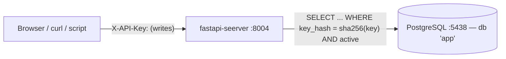

# Architecture

> Scope: the `fastapi-seerver` service. Status: **learning lab** — settings marked *lab-only* must change before real use.
> Sibling labs: `../../keycloak-jwt-python` (JWT), `../../oauth2-bff-python` (OAuth BFF), `../../keykloak-python` (Kerberos).
> This one is the simplest: an **API key**, no identity provider.

## 1. Purpose

A FastAPI resource server where **writes require an API key** sent in the `X-API-Key` header, and reads are public.
There is no login page and no Keycloak: an API key is a self-contained credential (a personal-access-token / M2M style).

The one idea: **the server stores a SHA-256 hash of each key; a request proves it holds a key by presenting it; the server hashes the presented value and looks for an active row with that hash.**

## 2. System context



No third party. The key's secret never leaves the client except as the header value; the database only ever holds its hash.

## 3. Service internals

```
app/
├── main.py           app, CORS (allows X-API-Key), router wiring, /health, /me
├── config.py         settings dict (APP_NAME, CORS_ORIGIN, DATABASE_URL)
├── dependencies.py   current_key: the whole auth check; require_login for writes
├── db.py             SQLAlchemy engine, session per request (get_db), Base
├── models/           apikeys.py (api_keys table + hash_key), users.py, profiles.py
├── routers/          users.py, profiles.py — writes declare dependencies=require_login
└── services/         plain CRUD over a Session
migrations/           0001 users+profiles, 0002 api_keys (+ seeds two demo keys)
```

Why `config.py` exists separately from `dependencies.py` (unlike the JWT lab): the API-key check needs a DB
session, so `dependencies.py` imports `get_db` from `db.py`. Keeping `settings` in `config.py` avoids a
`db.py ↔ dependencies.py` import cycle.

Rules the code follows: models depend only on Pydantic/SQLAlchemy/`db.Base`; services take a `Session` and
return Pydantic models (no HTTP); routers run no SQL; reads are public and each write opts in with
`dependencies=require_login`; schema changes only through Alembic (tests use SQLite `create_all`).

## 4. The authentication component

[`current_key`](../app/dependencies.py) is the only security-critical code:

| Check | How | Fails as |
|---|---|---|
| Header `X-API-Key` present | `APIKeyHeader(auto_error=False)` | 401 |
| Key is known | `SELECT ... WHERE key_hash = sha256(presented)` | 401 |
| Key is active (not revoked) | `AND active IS TRUE` | 401 |

On success it returns the `ApiKeyRow`; `/me` shows its `name` and `prefix` only. `require_login` runs the same
check for write endpoints.

## 5. Key decisions

| # | Decision | Why |
|---|---|---|
| D1 | **Key stored as SHA-256, never plaintext** | a database leak exposes no usable keys |
| D2 | **Revocation is an `active` flag** | disable a key without deleting the row or its audit trail |
| D3 | **Keys seeded by a migration** (not a runtime mint endpoint) | keeps the lab's logic to one table + one query; no key-management UI to explain |
| D4 | **`prefix` stored alongside the hash** | identify a key in listings / `/me` without revealing the secret |
| D5 | **Public reads, `require_login` per write** | website-style; explicit per endpoint, asserted by `tests/test_auth.py` |

## 6. Known gaps (fine for a lab, fix before real use)

1. **No per-key authorization / ownership** — any valid key can write anything.
2. **No expiry, no rotation, no rate limiting.**
3. **No mint/revoke API** — keys are seeded; real use needs a protected endpoint that returns a key once.
4. **Plain HTTP** — a key in a header is only safe over TLS. Serve HTTPS in production.
5. **Keys documented in the repo** — lab convenience only.

## 7. Testing

| Level | What | Where |
|---|---|---|
| Auth | no key / unknown key / revoked key → 401; valid → 201; reads → 200; `/me` hides the hash | [tests/test_auth.py](../tests/test_auth.py) |
| CRUD | create/read/update/list/cascade delete, 404s, duplicate → 409; SQLite, auth overridden | [tests/test_crud.py](../tests/test_crud.py) |
| Frontend | `SignInMenu` (guest field / stored-key view), `UserForm` | `../../frontend/src/**/*.test.tsx` |
