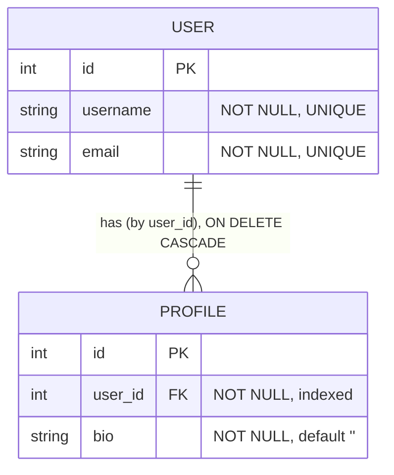
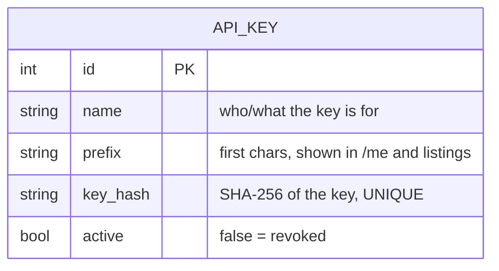

# Data model

> What data this service owns and the rules on it. Context: [architecture.md](architecture.md) · paths: [dataflow.md](dataflow.md).

Three tables in PostgreSQL database `app`.

## 1. Application entities

`User`/`Profile` are the CRUD demo data. Same as the other labs. See [models/users.py](../app/models/users.py),
[models/profiles.py](../app/models/profiles.py).

## 2. The credential: `api_keys`

[models/apikeys.py](../app/models/apikeys.py). The important rules:

- **`key_hash` is `sha256(key)`** — the raw key is never stored. There is no column that holds it.
- **`prefix`** lets a key be named/identified (e.g. in `/me`) without exposing the secret.
- **`active`** is the revocation switch: `current_key` only accepts rows where `active` is true.
- `api_keys` is **not linked** to `users`/`profiles` — a key authorizes writes; it doesn't own records. (A real
  system would tie keys to an owner and scope their permissions; out of scope for this lab.)

## 3. Seeded rows (migration 0002)

| name | active | plaintext (lab-only, documented) |
|---|---|---|
| `demo` | true | `mial_live_demo_do_not_use_in_prod` |
| `revoked-demo` | false | `mial_live_revoked_example` |

Only the hashes are inserted; the plaintext lives in the migration and `.env.example` so the lab works immediately.
