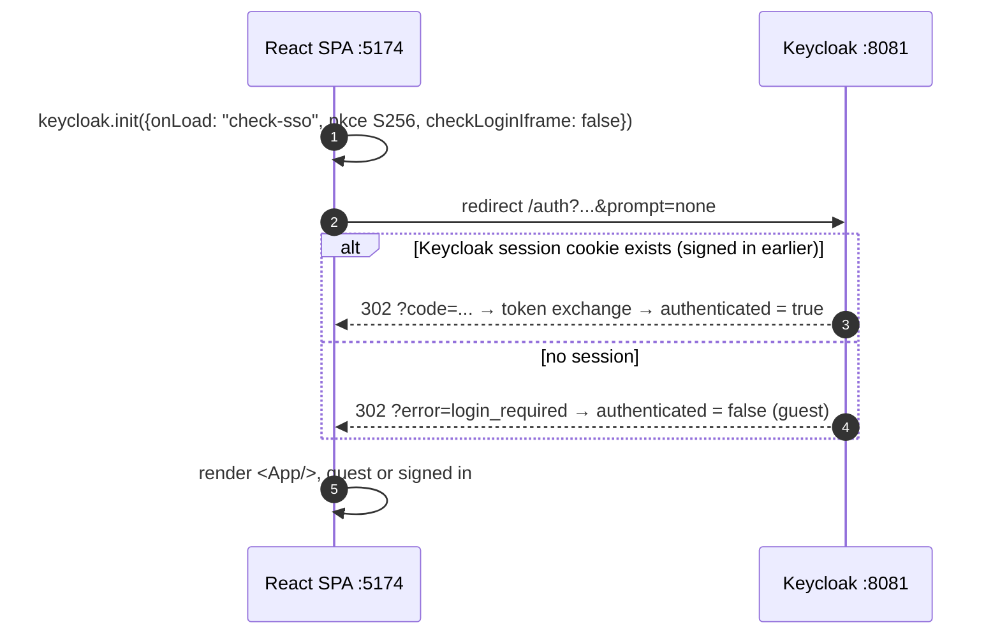
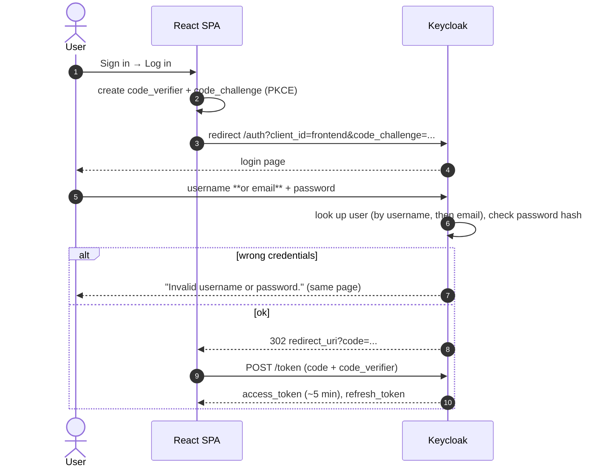
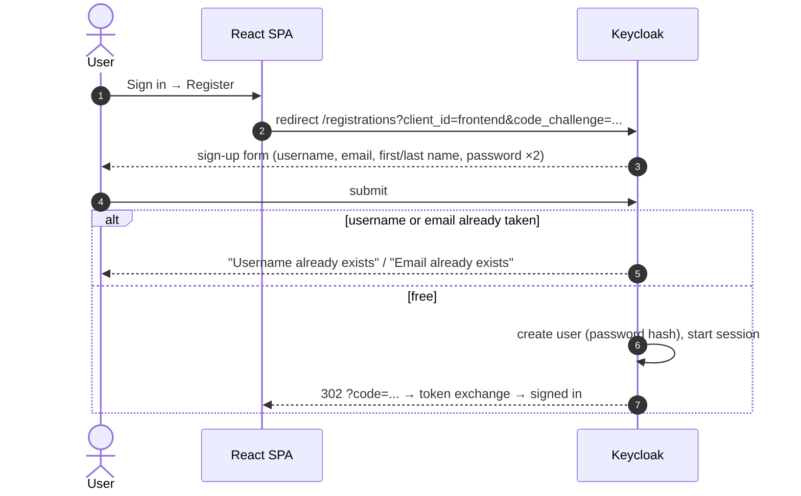
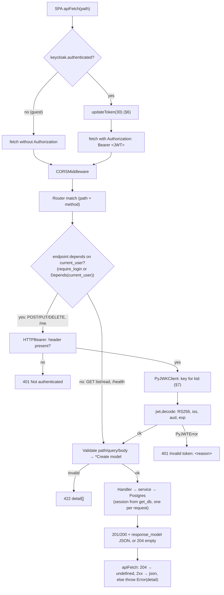
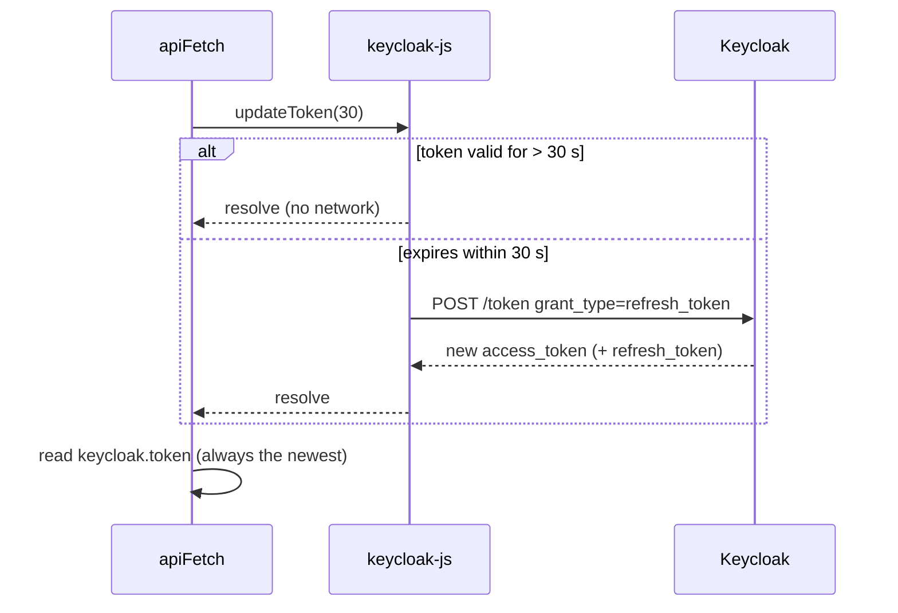
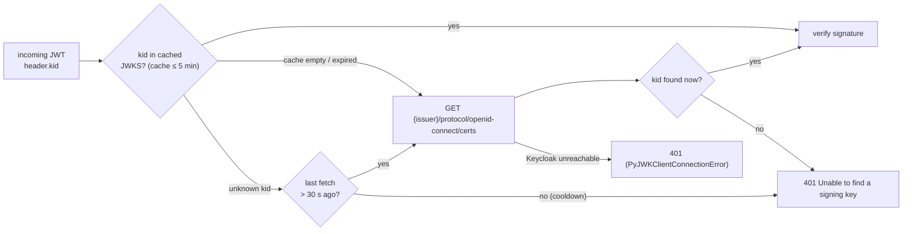

# Data flow

> How data and credentials move through the system, step by step, including failure paths.
> Structure: [architecture.md](architecture.md) · entities and claims: [datamodel.md](datamodel.md).

| Flow | When |
|---|---|
| [1. Page load: guest or returning user](#1-page-load-guest-or-returning-user) | every full page load |
| [2. Sign in → Log in](#2-sign-in--log-in) | user picks *Log in* |
| [3. Sign in → Register](#3-sign-in--register) | user picks *Register* |
| [4. Request pipeline](#4-request-pipeline-public-and-protected) | every API call |
| [5. CRUD flows](#5-crud-flows) | create / update / delete, cascade |
| [6. Token refresh](#6-token-refresh) | before each signed-in API call |
| [7. Signing keys and rotation](#7-signing-keys-jwks-and-rotation) | first verification, unknown `kid` |
| [8. CORS preflight](#8-cors-preflight) | browser, before non-simple requests |
| [9. Logout and revocation](#9-logout-and-revocation) | user clicks *Log out* |
| [10. Error reference](#10-error-reference) | all |

## 1. Page load: guest or returning user

The SPA never forces a login. Before rendering, it asks Keycloak, without any UI, whether a session already exists:



- `prompt=none` means Keycloak **never shows a page** here. A guest stays a guest until they click *Log in*.
- It's a **redirect**, not the hidden-iframe check (decision D11). The iframe would work in this lab, because `localhost:8081` and `localhost:5174` are the same site, but in production Keycloak has its own domain and browsers block its third-party cookies.
- Tokens stay in memory only, so every full reload repeats this round trip.

## 2. Sign in → Log in

`SignInMenu` → **Log in** → `keycloak.login()`:



- **The password only ever goes to Keycloak.** Neither the SPA's code nor the API sees it; Keycloak stores a hash in Postgres (database `keycloak`).
- **Username or email** both work (`loginWithEmailAllowed: true`). Verified: `alice` and `alice@example.com` both log in; a wrong password is rejected.
- **PKCE:** a stolen `code` is useless without the `code_verifier`, which never leaves the SPA.
- Brute-force protection, password policy, MFA and "forgot password" are realm settings in Keycloak. None are configured in this lab.

## 3. Sign in → Register

`SignInMenu` → **Register** → `keycloak.register()` opens Keycloak's sign-up page (`/protocol/openid-connect/registrations`):



- The new account lives in Keycloak's database. The API sees an ordinary token, the same as for `alice` ([datamodel.md §4](datamodel.md#4-identity-vs-application-data)).
- Verified end to end: registration redirects back already signed in, and the new user can log in again with the chosen password.
- Accounts survive Keycloak restarts and container recreates, because they're stored in Postgres.

## 4. Request pipeline: public and protected



Implementation details that matter:

- **Public endpoints ignore tokens.** A signed-in user's `GET /users/` carries a token, and the API doesn't look at it. A guest's request carries none and gets the same data.
- **Order of checks** (verified on FastAPI 0.143):
  - **Malformed JSON** (not parseable at all) is rejected with **422 `json_invalid` before auth**, even without a token.
  - A **well-formed body that fails the schema** plus a bad or missing token gets **401, not 422**: dependencies (auth) run before schema errors are reported, so unauthenticated callers learn nothing about the schema.
- **Threading:** handlers and `current_user` are plain `def` and run in FastAPI's thread pool. The JWKS fetch and the SQL (psycopg) don't block the event loop. Each request gets its own DB session from the pool; Postgres identity columns and constraints keep concurrent writes consistent.
- **Claims:** `require_login` verifies the token but discards the claims. `/me` declares `Depends(current_user)` to get them.
- **Error text on the client:** [`apiFetch`](../../frontend/src/auth/apiFetch.ts) shows a string `detail` as-is and flattens a 422 list into `"<field>: <msg>, ..."`.

## 5. CRUD flows

All writes go through the same pattern in the UI: a form → `apiFetch` → the list is **fetched again** instead of patched locally, so the screen always shows server state.

**Create user** (`UserForm` in create mode → `Users.tsx`):

```mermaid
sequenceDiagram
    participant F as UserForm (create)
    participant U as Users.tsx
    participant API as routers/users.py
    participant S as services/users.py
    participant DB as Postgres (db "app")

    F->>F: browser checks required + type=email
    F->>U: onSubmit({username, email})
    U->>API: POST /users/ + Bearer
    API->>API: require_login → 401 · UserCreate validation → 422
    API->>S: create_user(db, data)
    S->>DB: INSERT INTO users … ; COMMIT
    alt username or email taken
        DB-->>S: unique violation (IntegrityError)
        S-->>API: raises → main.py handler → 409, session rolled back
        API-->>U: 409 "Already exists …" → shown under the form
    else ok
        DB-->>S: row with identity id
        API-->>U: 201 User
    end
    U->>U: reload GET /users/, call onChange() → App bumps version → Profiles reloads
    F->>F: clear inputs
```

**Update** (`Edit` → inline `UserForm`/`ProfileForm` prefilled → `PUT /{id}` with **all** fields):
- user: 404 if the id is gone, e.g. deleted in another tab;
- profile: 404 if the profile **or the new owner** is missing. The `<select>` only offers existing users, and the form submits exactly the owner it displays.

**Delete user, with cascade:**

```mermaid
sequenceDiagram
    participant U as Users.tsx
    participant API as routers/users.py
    participant SU as services/users.py
    participant DB as Postgres (db "app")
    participant App as App.tsx / Profiles.tsx

    U->>U: confirm("Delete X and all of their profiles?")
    U->>API: DELETE /users/{id} + Bearer
    API->>SU: delete_user(db, id)
    SU->>DB: DELETE FROM users WHERE id = … ; COMMIT
    DB->>DB: ON DELETE CASCADE removes that user's profiles (same transaction)
    API-->>U: 204 (no body)
    U->>App: onChange() → version+1
    App->>App: Profiles reloads GET /profiles/ + GET /users/ (owner names)
```

| Stage | Shape |
|---|---|
| Form state | `UserCreate` / `ProfileCreate` (TS) |
| Wire (request) | JSON body. `PUT` sends the full object |
| Validated | `*Create` (Pydantic). Email normalised by `email-validator` |
| Stored | row in `users`/`profiles` (`UserRow`/`ProfileRow`), id from the identity column |
| Returned by the service | `User`/`Profile` Pydantic model built from the row (`model_validate`) |
| Wire (response) | through `response_model`, or **204 with no body** for `DELETE` |

## 6. Token refresh

Only for signed-in users. Guests skip it (`apiFetch` checks `keycloak.authenticated`).



- No background timer; the refresh happens right before a call, so idle tabs don't talk to Keycloak.
- If the refresh token has also expired (SSO session ended), `updateToken` rejects and the call fails. After a reload, `check-sso` (§1) finds no session and the user is a **guest** again. They click *Log in* and enter their password again.
- The 30 s margin covers network delay and small clock differences.

## 7. Signing keys (JWKS) and rotation



- **Startup does no network I/O.** `PyJWKClient` fetches only on the first verification. With Keycloak down, the API starts, `/health` is green, and **public reads keep working**. Only protected endpoints fail, with 401.
- **Rotation:** an unknown `kid` forces a fresh fetch of the key set, so no restart is needed. PyJWT allows that forced refresh **at most once per 30 s** (`cooldown_duration`). Garbage `kid`s can't make the API hammer Keycloak, but a token signed with a key rotated in the last 30 s may be rejected once; the client retries after a refresh.
- **Keycloak outage:** cached keys keep existing tokens verifying for up to 5 min (decision D2).

## 8. CORS preflight

The SPA (`localhost:5174`) and the API (`localhost:8001`) are different origins. `apiFetch` always sends `Content-Type: application/json`, and signed-in calls also send `Authorization`, so the browser sends a preflight first, **even for a guest's `GET`**:

```
OPTIONS /users/   Origin: http://localhost:5174
                  Access-Control-Request-Method: POST
                  Access-Control-Request-Headers: authorization,content-type
→ 200 Access-Control-Allow-Origin: http://localhost:5174
```

`CORSMiddleware` answers before routing or auth, so a preflight never needs a token. Only `Authorization` and `Content-Type` are allowed. Add new custom headers to `allow_headers` in [main.py](../app/main.py).

## 9. Logout and revocation

```
SignInMenu "Log out" → keycloak.logout({redirectUri}) → Keycloak ends the SSO session → back to the SPA → check-sso → guest
```

- **The API isn't told.** An access token already issued stays valid **until `exp` (up to ~5 min)** because verification is local (D2). Use token introspection for endpoints that need instant revocation.
- Logout ends the Keycloak session, so the next *Log in* asks for the password again. (In the sibling Kerberos project it doesn't, because the workstation's Kerberos ticket logs the user straight back in.)

## 10. Error reference

| Status | Produced by | Body | Typical cause |
|---|---|---|---|
| 204 | `DELETE` routes | empty | success. `apiFetch` returns `undefined` |
| 401 | `HTTPBearer` | `{"detail": "Not authenticated"}` | write or `/me` without a token, e.g. a guest calling `POST` directly (older FastAPI versions return 403) |
| 401 | `current_user` | `{"detail": "Invalid token: <PyJWT message>"}` + `WWW-Authenticate: Bearer` | expired token, wrong `aud`/`iss`, bad signature, unknown `kid`, Keycloak unreachable for JWKS |
| 404 | routers | `{"detail": "User not found"}` / `"Profile not found"` | unknown id, deleted in the meantime, or a profile pointing to a missing user |
| 409 | `IntegrityError` handler (`main.py`) | `{"detail": "Already exists (username and email must be unique)"}` | duplicate username or email on create/update. The transaction is rolled back |
| 422 | Pydantic | `{"detail": [{"loc": [...], "msg": "...", "type": "..."}]}` | missing field, invalid email (including reserved names like `.local`), wrong types, non-integer path id |
| 500 | unhandled | plain text | database unreachable (wrong `DATABASE_URL`, container stopped, RDS security group): psycopg `OperationalError`. Check `alembic current` from `fastapi-seerver/` |

Keycloak-side errors, shown as Keycloak pages and never reaching the API:

| Symptom | Cause |
|---|---|
| Log in → "Invalid username or password." | wrong password, or no such user (Keycloak doesn't say which, on purpose) |
| Register → "Username already exists" / "Email already exists" | the name or email belongs to another Keycloak account (emails are unique: `duplicateEmailsAllowed: false`) |
| Register → "Invalid password: …" | a realm password policy rejected it (none is set in this lab) |
| "Invalid parameter: redirect_uri" | the app's address isn't in the `frontend` client's redirect URIs (`http://localhost:5174/*`). Did you open the app on another port? |
| Realm `jwt-lab` not found (404 on `/realms/jwt-lab`) | the import didn't run: the file must be named `jwt-lab-realm.json`, and it's only imported on a first start |

Debugging tips:

- **401 "Invalid issuer":** the token came through a different hostname than `KEYCLOAK_ISSUER`. Decode it, compare `iss`, and fix `KC_HOSTNAME` or the URL the SPA uses.
- **401 "Invalid token: Audience doesn't match":** the audience mapper is missing on the client that issued the token (`azp`).
- **401 right after login:** compare the clocks of the Keycloak container and the host. With zero leeway, a clock difference can make fresh tokens look invalid.
