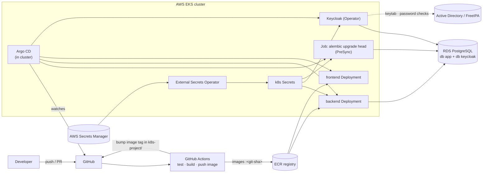

# Deployment: CI/CD, secrets and Kubernetes

> **Status: target design, not built yet.** Today everything runs on one Windows machine (see [architecture.md §4](architecture.md#4-deployment-topology-lab)).
> This document describes how the same system moves to production: **GitHub Actions** builds and ships it, a **secrets manager** holds its passwords, and **Kubernetes** runs it.
> Companion docs: [architecture.md](architecture.md) · [datamodel.md](datamodel.md) · [dataflow.md](dataflow.md).

## 1. Today vs. production

| Concern | Lab today | Production target |
|---|---|---|
| Build and test | by hand: `pytest`, `npm test`, `npm run build` | **GitHub Actions** on every pull request |
| Ship | `scripts/setup-local-dev.ps1` | GitHub Actions builds images → registry → **Argo CD** deploys |
| Run | `docker compose` + `fastapi dev` + `npm run dev` | **Kubernetes** (AWS EKS): Deployments, Services, Ingress |
| Passwords and keys | `.env` files (gitignored) | **AWS Secrets Manager** → External Secrets Operator → Kubernetes Secrets |
| Database | Postgres container on `:5434` | **AWS RDS** for PostgreSQL (already supported: change `DATABASE_URL`/`KC_DB_URL`) |
| Kerberos KDC | MIT KDC container, realm `LAB.LOCAL` | the company's **Active Directory** or **FreeIPA**, outside the cluster |
| Keycloak | `start-dev`, plain HTTP | **Keycloak Operator**, production mode (`start`), TLS, 2+ replicas |
| TLS | none (`sslRequired: none`) | HTTPS everywhere: ingress with AWS ACM or cert-manager certificates |



## 2. Code changes required first

These block a production deployment. Each is small.

| # | Change | Why | Where |
|---|---|---|---|
| P1 | **`Dockerfile` for the backend** | CI needs an image. Run `fastapi run app/main.py` (uvicorn, no auto-reload) as a non-root user, behind the ingress with proxy headers | `fastapi-seerver/Dockerfile` |
| P2 | **`Dockerfile` for the frontend** | multi-stage: `npm ci && npm run build`, then nginx serving `dist/` | `frontend/Dockerfile` |
| P3 | **Frontend URLs from configuration** | Keycloak URL, realm, client id and API URL are **hardcoded** in `frontend/src/auth/keycloak.ts` and `apiFetch.ts`. Use `import.meta.env.VITE_*` set at build time (one image per environment), or a runtime `config.json` served by nginx (one image for all) | `frontend/src/auth/` |
| P4 | **`/ready` endpoint** | Kubernetes should only send traffic when the DB is reachable. `/health` stays a cheap liveness check; `/ready` runs `SELECT 1` | `app/main.py` |
| P5 | **Keycloak production config** | `start` instead of `start-dev`, a real hostname, TLS, `KC_PROXY_HEADERS=xforwarded`; the realm import job replaces `--import-realm`, and `init.sh` settings move into the realm config or a Keycloak config CLI step | Keycloak CR / `keycloak/` |
| P6 | **Production keytab** | the SPN must match the public hostname: `HTTP/keycloak.example.com@EXAMPLE.COM`, issued by AD/FreeIPA (§6) | secrets manager |
| P7 | **Pin dependency versions** | reproducible images. Use a lock file (`uv lock` / `pip-compile`) instead of unpinned `requirements.txt` | `fastapi-seerver/` |

## 3. GitHub Actions: CI/CD

### 3.1 What runs when

| Trigger | Job | Steps |
|---|---|---|
| Pull request touching `fastapi-seerver/**` | **backend-ci** | `pip install -r requirements.txt` → `pytest` (SQLite, no services needed) → `alembic upgrade head --sql` (renders the migration SQL as a check) |
| Pull request touching `frontend/**` | **frontend-ci** | `npm ci` → `npm test` → `npm run build` (strict `tsc`) |
| Push to `main` | **build-and-push** | build both images, tag them with the **git SHA**, push to ECR. Scan them (e.g. Trivy) |
| Push to `main`, after build | **deploy** | commit the new tag to `k8s-project/overlays/prod/kustomization.yaml`; Argo CD notices and syncs |

Path filters (`on.pull_request.paths`) keep a frontend-only change from running backend jobs, which matters in a monorepo.

### 3.2 Example: backend CI

`.github/workflows/backend-ci.yml` (repo root):
```yaml
name: backend-ci
on:
  pull_request:
    paths: ["auth/keykloak-python/fastapi-seerver/**"]
jobs:
  test:
    runs-on: ubuntu-latest
    defaults:
      run:
        working-directory: auth/keykloak-python/fastapi-seerver
    steps:
      - uses: actions/checkout@v4
      - uses: actions/setup-python@v5
        with: { python-version: "3.12", cache: pip }
      - run: pip install -r requirements.txt
      - run: pytest
```

### 3.3 How the pipeline reaches AWS

**No stored AWS keys.** GitHub Actions gets short-lived credentials through **OIDC**: an IAM role trusts `token.actions.githubusercontent.com` for this repository and branch, and the workflow uses `aws-actions/configure-aws-credentials` with `role-to-assume`. The role may only push to ECR. Argo CD does the deploying from inside the cluster, so CI never needs cluster-admin rights.

### 3.4 Rules
- **Branch protection on `main`:** CI must pass, plus at least one review.
- **Images are immutable:** tag by git SHA, never `latest`. Rolling back means pointing the tag back.
- **Migrations before code:** the migration Job runs as an Argo CD **PreSync** hook (`argocd.argoproj.io/hook: PreSync`). Write migrations backwards compatible (add nullable → backfill → enforce in a later release), so the old pods keep working during the rollout ([datamodel.md §6](datamodel.md#6-schema-and-migrations)).

## 4. Secrets management

### 4.1 Inventory

Everything below is in `.env` files or the repo today and must move:

| Secret | Used by | Lab today | Production store | Kubernetes Secret |
|---|---|---|---|---|
| `DATABASE_URL` (role `app` password) | backend, migration Job | `fastapi-seerver/.env`, and `APP_DB_PASSWORD` in the root `.env` (used to create the role) | Secrets Manager `prod/app/database` | `app-db` |
| Keycloak DB password (role `keycloak`) | Keycloak | `.env` `KEYCLOAK_DB_PASSWORD` | `prod/keycloak/database` | `keycloak-db` |
| Postgres admin / RDS master password | only `create-databases.sql`, by an operator | `.env` `POSTGRES_ADMIN_PASSWORD` | RDS-managed master secret | none (not given to apps) |
| Keycloak admin account | operators | `admin/admin` in `docker-compose.yml` and `keycloak/init.sh` | `prod/keycloak/admin`; better, an admin group in AD | `keycloak-admin` |
| **Keycloak keytab** | Keycloak (SPNEGO) | generated by the KDC container | `prod/keycloak/keytab` (binary, base64) | `keycloak-keytab`, mounted as a file |
| KDC master password, lab user password `alice123` | the KDC | `kdc/entrypoint.sh` | n/a: AD/FreeIPA owns them | none |

**Not secrets** (plain `ConfigMap`): `KEYCLOAK_ISSUER`, `KEYCLOAK_AUDIENCE`, `CORS_ORIGIN`, `krb5.conf`, the realm JSON. Rule of thumb: if leaking it doesn't let someone in, it's config.

### 4.2 Two different secret stores

| | **GitHub Secrets / Variables** | **AWS Secrets Manager** |
|---|---|---|
| For | the **pipeline** | the **running application** |
| Holds | AWS account id, IAM role ARN to assume (via OIDC, not keys), registry name | database passwords, keytab, Keycloak admin |
| Read by | GitHub Actions jobs | pods, through External Secrets Operator |
| Never | runtime secrets (they'd end up in build logs or images) | CI credentials |

### 4.3 From the secrets manager to a pod

```
AWS Secrets Manager          External Secrets Operator           Kubernetes Secret          pod
"prod/app/database"   ──►    ExternalSecret (refresh 1h)   ──►   "app-db"            ──►   env DATABASE_URL
                             auth: IRSA (IAM role for its
                             service account, read-only)
```

- **The app code doesn't change.** It reads `DATABASE_URL` from the environment exactly as it does with `.env` today ([dependencies.py](../app/dependencies.py)).
- **Rotation:** rotate in Secrets Manager (RDS supports managed rotation). ESO updates the Secret, and a rollout restart (or Reloader) picks it up.
- Encrypt Kubernetes Secrets at rest with a KMS key (an EKS setting). Restrict `get secrets` with RBAC.

## 5. Kubernetes

### 5.1 Component mapping

| Component | Objects | Key settings |
|---|---|---|
| **backend** | `Deployment` (2+ replicas), `Service`, `Ingress` `api.example.com`, `HorizontalPodAutoscaler`, `PodDisruptionBudget` | `envFrom`: ConfigMap `backend-config` + Secret `app-db`. Liveness `/health`, readiness `/ready` (P4). CPU/memory requests and limits. Non-root, read-only root filesystem |
| **migrations** | `Job` running `alembic upgrade head` (same backend image), Argo CD PreSync hook | Secret `app-db`. Must finish before the new backend pods start |
| **frontend** | `Deployment` (nginx), `Service`, `Ingress` `app.example.com` | static files only; config per P3 |
| **Keycloak** | **Keycloak Operator** + `Keycloak` custom resource, 2+ instances, `Ingress` `keycloak.example.com` | `db`: RDS `keycloak` via Secret `keycloak-db`; keytab Secret mounted at `/keytabs`; `krb5.conf` ConfigMap mounted at `/etc/krb5.conf`; hostname = the SPN's host |
| **Postgres** | none: **RDS**, outside the cluster | private subnets, security group allows only the cluster's nodes. The two databases and roles come from `postgres/create-databases.sql`, run once by an operator |
| **KDC** | none: **AD / FreeIPA** | the cluster must reach it on port 88 (TCP), for Keycloak's password checks and username lookups |
| **cluster-wide** | ingress controller (AWS Load Balancer Controller), cert-manager or ACM, External Secrets Operator, Argo CD, metrics-server | `NetworkPolicy`: backend → RDS and Keycloak only; nothing reaches Keycloak's admin endpoints from the internet |

### 5.2 Repository layout (`../../k8s-project/`, Kustomize)

```
k8s-project/
├── base/
│   ├── backend/        deployment.yaml  service.yaml  ingress.yaml  configmap.yaml  hpa.yaml
│   ├── migrations/     job.yaml                     (PreSync hook)
│   ├── frontend/       deployment.yaml  service.yaml  ingress.yaml
│   └── keycloak/       keycloak.yaml (CR)  krb5-configmap.yaml  realm-import.yaml
└── overlays/
    ├── dev/            Docker Desktop Kubernetes: 1 replica, local images, *.localtest.me hosts, plain Secrets
    └── prod/           EKS: replicas, ECR image tags (bumped by CI), ExternalSecrets, real hostnames
```

`base/` holds what's the same everywhere, and overlays patch only the differences. **No secret values are ever committed**: `dev` creates them with `kubectl create secret` from the local `.env`, and `prod` uses `ExternalSecret` objects.

### 5.3 Backend Deployment (sketch)

```yaml
apiVersion: apps/v1
kind: Deployment
metadata: { name: backend }
spec:
  replicas: 2
  selector: { matchLabels: { app: backend } }
  template:
    metadata: { labels: { app: backend } }
    spec:
      securityContext: { runAsNonRoot: true }
      containers:
        - name: api
          image: <account>.dkr.ecr.<region>.amazonaws.com/fastapi-seerver:<git-sha>
          command: ["fastapi", "run", "app/main.py", "--port", "8000", "--proxy-headers"]
          ports: [{ containerPort: 8000 }]
          envFrom:
            - configMapRef: { name: backend-config }   # KEYCLOAK_ISSUER, KEYCLOAK_AUDIENCE, CORS_ORIGIN
            - secretRef: { name: app-db }              # DATABASE_URL (synced from Secrets Manager)
          livenessProbe:  { httpGet: { path: /health, port: 8000 } }
          readinessProbe: { httpGet: { path: /ready,  port: 8000 } }   # P4
          resources:
            requests: { cpu: 100m, memory: 128Mi }
            limits:   { memory: 256Mi }
```

Multiple replicas are safe now, because all state is in Postgres (D6) and token checks are local (D2). The database connection pool is per pod, so keep `replicas × pool size` below RDS `max_connections`.

## 6. Kerberos in production

What changes compared with the lab:

| | Lab | Production |
|---|---|---|
| Realm | `LAB.LOCAL` (our KDC container) | the company realm, e.g. `EXAMPLE.COM` (AD domain) |
| Users | `kadmin addprinc` | existing domain accounts |
| Keycloak's SPN | `HTTP/keycloak.lab.local` | **`HTTP/keycloak.example.com`**: must equal the hostname users type |
| Keytab | exported by our `entrypoint.sh` | AD: a service account + `ktpass` (or `setspn` + a keytab tool). FreeIPA: `ipa service-add` + `ipa-getkeytab`. Stored in Secrets Manager (§4) |
| Browser trust | Firefox prefs written by `scripts/setup-local-dev.ps1` (autoconfig `mozilla.cfg`), MIT Kerberos for Windows | Group Policy: add `keycloak.example.com` to the Intranet zone (Edge/Chrome use SSPI and **just work** on domain-joined PCs) |
| Keycloak config | Kerberos user federation | usually **LDAP federation with Kerberos authentication** against AD, which also brings real names, emails and groups. That fixes `VERIFY_PROFILE` and roles (architecture gap 1) properly |

**Registration** stays a Keycloak-only feature (D9). In companies it's usually **switched off**, because accounts come from AD.

## 7. Rollout plan

Free and testable on this machine first, then AWS:

1. [ ] P1–P4: Dockerfiles, configurable frontend, `/ready`.
2. [ ] GitHub Actions **CI** (§3.2) for backend and frontend.
3. [ ] `k8s-project/` base + **dev overlay** on Docker Desktop Kubernetes (Settings → Kubernetes). Postgres and the KDC can stay in Compose for this step.
4. [ ] AWS foundation with **Terraform**: VPC, EKS, RDS, ECR, Secrets Manager entries, IAM roles (GitHub OIDC, ESO via IRSA).
5. [ ] Cluster add-ons: ingress controller, cert-manager/ACM, External Secrets Operator, Argo CD, Keycloak Operator.
6. [ ] **CD**: build → push → bump tag → Argo CD sync, migrations as PreSync.
7. [ ] Production Kerberos (§6): SPN, keytab, Keycloak LDAP/Kerberos federation against AD.
8. [ ] Hardening from [architecture.md §6](architecture.md#6-known-gaps-and-risks): authorization, `exp` required, observability, backups (RDS automated snapshots + point-in-time recovery).
