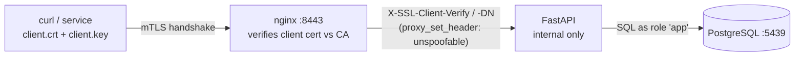

# Architecture

> Scope: the `fastapi-seerver` service and the nginx proxy that terminates mTLS in front of it.
> Status: **learning lab** — self-signed CA, no revocation, plain internal HTTP. Harden before real use.
> Sibling labs: `../../keycloak-jwt-python` (JWT), `../../oauth2-bff-python` (OAuth BFF), `../../api-key-python` (API key).

## 1. Purpose

A FastAPI resource server where **writes require a client TLS certificate** that our CA signed; reads are public.
The client proves identity at the TLS handshake, not with a token or password.

The central idea: **TLS (and the client-cert check) is terminated at nginx; FastAPI trusts nginx's verdict,
forwarded as headers, because nothing but nginx can reach FastAPI.**

## 2. System context



uvicorn can't expose the peer certificate to the ASGI app, so a TLS-terminating proxy is required to surface the
client-cert result. That is nginx's whole job here.

## 3. Service internals

```
app/
├── main.py          app, CORS, router wiring, /health, /me
├── config.py        settings (APP_NAME, CORS_ORIGIN, DATABASE_URL)
├── dependencies.py  current_cert: require X-SSL-Client-Verify == SUCCESS; parse the CN
├── db.py            engine, session per request, Base
├── models/          users.py, profiles.py
├── routers/         users.py, profiles.py — writes declare dependencies=require_login
└── services/        plain CRUD
```

Same layering rules as the sibling labs: models→Pydantic/SQLAlchemy only; services take a `Session`, no HTTP;
routers run no SQL; reads public, each write opts in with `dependencies=require_login`; schema via Alembic.

## 4. The authentication component

[`current_cert`](../app/dependencies.py):

| Check | How | Fails as |
|---|---|---|
| nginx verified a client cert | `X-SSL-Client-Verify == "SUCCESS"` | 401 (also for `NONE` / `FAILED:*`) |
| identity | CN parsed from `X-SSL-Client-DN` (e.g. `CN=alice`) | returned to `/me` |

The real verification (signature, chain to our CA, validity) happens in **nginx** (`ssl_verify_client optional`
+ `ssl_client_certificate ca.crt`). FastAPI only reads the verdict.

## 5. The trust boundary (most important)

FastAPI accepts `X-SSL-*` as truth. That is safe **only** because FastAPI is not reachable except through nginx:
in `docker-compose.yml` the `server` service publishes no host port, so a caller can't connect to it to forge
the headers. Lift that (publish the port) and mTLS is bypassable. Production equivalent: network policy / a
private subnet, optionally a shared secret between proxy and app.

## 6. Key decisions

| # | Decision | Why |
|---|---|---|
| D1 | **nginx terminates mTLS, forwards headers** | uvicorn can't give the app the client cert; this is the standard LB/ingress pattern |
| D2 | **`ssl_verify_client optional`** | reads stay public; the app gates writes, matching the other labs |
| D3 | **`server` unpublished** | makes the forwarded headers trustworthy by topology, not by hope |
| D4 | **Self-signed CA via a script** | zero external dependencies; `make-certs` is re-runnable |
| D5 | **curl-first, no SPA** | mTLS is machine/transport auth; a browser needs cert import + self-signed trust, which obscures the lesson |

## 7. Known gaps (lab only)

1. **No revocation (CRL/OCSP).** A leaked client key is valid until expiry.
2. **CA-level trust only.** Any cert the CA signed passes; no per-CN allowlist or roles.
3. **Self-signed server cert.** Clients must pin our CA (`--cacert`); browsers warn.
4. **Header trust depends on topology.** Documented and enforced by the unpublished server, but add network policy in prod.

## 8. Testing

| Level | What | Where |
|---|---|---|
| Auth | `X-SSL-Client-Verify` SUCCESS→201, NONE/FAILED/missing→401; reads 200; `/me` returns the CN | [tests/test_auth.py](../tests/test_auth.py) |
| CRUD | create/read/update/list/cascade/409, auth overridden, SQLite | [tests/test_crud.py](../tests/test_crud.py) |
| E2E | curl with/without a client cert through nginx (see [../../README.md](../../README.md)) | by hand |
