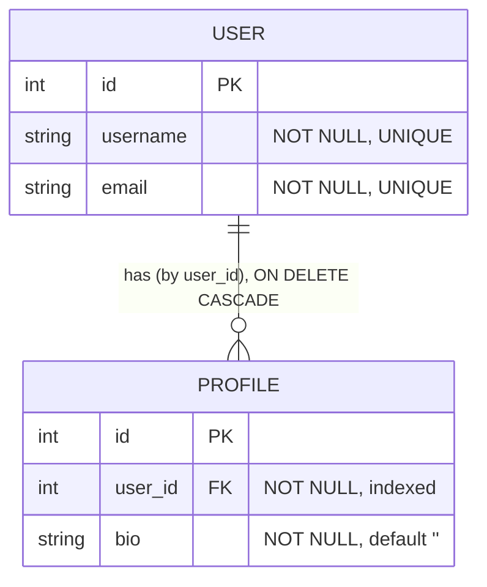

# Data model

> What data this service owns. Context: [architecture.md](architecture.md) · paths: [dataflow.md](dataflow.md).

Two tables in PostgreSQL database `app` — the users-and-profiles CRUD, identical to the sibling labs.

See [models/users.py](../app/models/users.py), [models/profiles.py](../app/models/profiles.py), migration
`0001`.

## The credential is NOT in the database

Unlike the API-key lab, there is **no credentials table**. The identity is the **client X.509 certificate**,
and the trust anchor is the **CA** (`certs/ca.crt`), used by nginx to verify it. FastAPI only ever sees the
verified CN (`X-SSL-Client-DN`), never a stored secret. Nothing about the caller is persisted — a client cert
authorizes a write; it doesn't own the row (no owner/role model in this lab).
