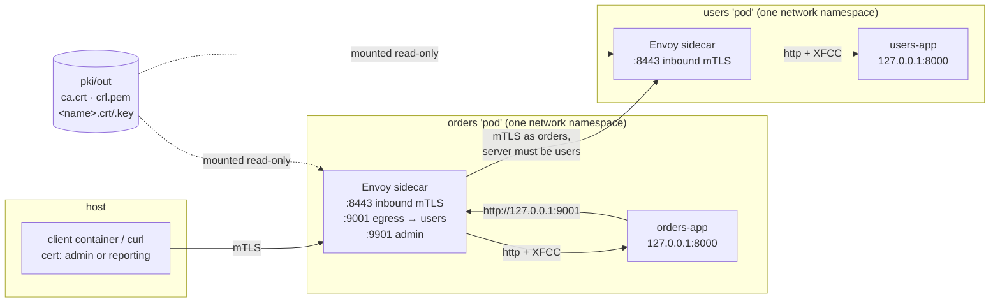

# Architecture

> Service-to-service authentication with **mutual TLS**, the way service meshes (Istio, Linkerd, Consul, SPIRE) do it.
> Flows: [dataflow.md](dataflow.md) · real-world mapping: [production.md](production.md).
> Status: **learning lab**. Lab shortcuts are listed in §6.

## 1. Purpose

Two services must trust each other **without passwords, API keys or tokens**. Each workload holds an **X.509 certificate** whose identity is a **SPIFFE ID** (`spiffe://lab.local/orders`). Every connection is mutual TLS: both sides prove who they are with their certificate, signed by a CA everyone trusts.

The key design point, as in every service mesh: **the apps don't do any of this.** A sidecar proxy (Envoy) next to each app:
- does mTLS both ways;
- checks the CA, revocation (CRL), and the identity format;
- tells the app who called, in one header.

The app's only security job is **authorization**: is this caller allowed to do this?

## 2. Components



| Component | Job | Trusts |
|---|---|---|
| **Lab CA** (`pki/pki.sh`, runs in a container with no network) | Issues workload certificates (SPIFFE ID in the URI SAN, 24 h), revokes them (CRL), creates a foreign CA for tests | — |
| **Envoy sidecar, inbound** (`:8443`) | Requires a client certificate that chains to the lab CA, isn't on the CRL, and has a `spiffe://lab.local/` URI SAN. Forwards the verified identity in `x-forwarded-client-cert` | the lab CA only |
| **Envoy sidecar, egress** (orders only, `127.0.0.1:9001`) | Opens mTLS to users, **presents the orders certificate**, and **accepts only a server whose SPIFFE ID is exactly `spiffe://lab.local/users`** | the lab CA + exact server identity |
| **users-app, orders-app** (FastAPI) | Business logic + **authorization by caller identity**. Listen on 127.0.0.1 only | the XFCC header, because only the sidecar can reach them |
| **client** container | Calls services as any identity (`call.py`) and runs the scenario checks | the lab CA (it verifies the servers too) |

## 3. Trust boundaries (the important part)

1. **The CA is the root of all trust.** Anyone holding `pki/out/ca.key` can mint `spiffe://lab.local/admin`. In production the CA key lives in an HSM, KMS or SPIRE server, never on a developer's disk.
2. **The sidecar is the only way into the app.** The app binds `127.0.0.1` inside the sidecar's network namespace, so other containers can't reach port 8000. Verified: scenario 6 (`http://users-app:8000` → connection refused).
3. **The app trusts the `x-forwarded-client-cert` header** only because of boundary 2. The sidecar uses `forward_client_cert_details: SANITIZE_SET`: whatever header the caller sent is **discarded**, and the sidecar writes the verified one. Verified: scenario 5 (reporting forges `URI=spiffe://lab.local/admin` and is still seen as `reporting`).
4. **Identity is the SPIFFE ID, not the hostname.** A certificate's DNS names exist only so clients can verify they reached the right host. Authorization uses `spiffe://lab.local/<name>`.
5. **Both directions are verified.** Orders checks that it's really talking to users (exact SAN match). Verified: with the users sidecar swapped onto a valid lab certificate for a *different* identity (`reporting`), orders refused (`ssl.fail_verify_san`) and returned 502, instead of sending data to an impostor.

## 4. App code ([dependencies.py](../users-service/app/dependencies.py))

```python
caller_identity(request)   # XFCC "URI=spiffe://lab.local/<name>" → "<name>", 401 if missing or foreign
require_caller("admin")    # dependency: 403 unless the caller is in the list
```
Authorization table (`require_caller` on each route):

| Route | Allowed |
|---|---|
| users `GET /users/`, `GET /users/{id}` | orders, admin, reporting |
| users `POST /users/` | admin |
| orders `POST /orders/` | admin. Orders then calls users **as itself** (`orders`), and users allows that read |
| orders `GET /orders/` | admin, reporting |
| `/whoami` | any valid lab identity |

The XFCC parser takes the **last** element (`split(",")[-1]`), which is the one our own sidecar added. With `SANITIZE_SET` there is only one anyway.

## 5. Decisions

| # | Decision | Why | Cost / revisit when |
|---|---|---|---|
| D1 | **Sidecar does TLS, app does authz** | Same as every mesh: no crypto code in apps, one place to configure ciphers, CA, CRL; any language works | Each pod runs an extra proxy (CPU and memory per pod). Ambient/sidecar-less meshes (Istio ambient, Cilium) move it to a node-level proxy |
| D2 | **SPIFFE IDs in the URI SAN as the identity** | The standard workload-identity format (SPIFFE); used by Istio, Linkerd and SPIRE. Survives IP and hostname changes | Needs a naming scheme (`spiffe://<trust-domain>/ns/<ns>/sa/<sa>` in Istio) |
| D3 | **XFCC header with `SANITIZE_SET`** | Standard Envoy way to hand the verified identity to the app; spoof-proof by construction | Only safe if the app is unreachable except via the sidecar (boundary 2) |
| D4 | **Egress pins the server's SPIFFE ID (exact match)** | "Signed by our CA" isn't enough: any workload has such a certificate. Orders must talk to *users* | A list per destination; a mesh generates it from service discovery |
| D5 | **Short-lived certificates (24 h) + rotation command** | A stolen key expires quickly; rotation is routine, not an emergency | Something must rotate on time. In the lab that's a manual `rotate`; meshes do it automatically every few hours |
| D6 | **CRL for revocation** | Shows that a certificate can be cut off before it expires | CRLs must be distributed and refreshed (the lab CRL lasts 30 days). Meshes mostly rely on very short lifetimes instead |
| D7 | **Envoy reloads by restart** | Simplest config (files) | Brief interruption. Production uses SDS (Secret Discovery Service) for hot reload without restart |
| D8 | **CA and tools in containers** (`pki`, `client`) | Same commands on Windows and macOS; no host openssl/curl differences | Docker required for everything |
| D9 | **In-memory data** | The lab is about transport identity | Data is lost on app restart; the other labs show Postgres |

## 6. Lab shortcuts (not for production)

- The CA key sits in `pki/out/ca.key` on disk (production: HSM, KMS or SPIRE, with an offline root and intermediate CAs).
- Private keys are mode `644` so the non-root Envoy user can read the bind mount (production: keys stay in memory, delivered via SDS).
- Certificates are issued and rotated by hand/script (production: automatic, every few hours).
- One flat trust domain, no intermediate CA, no namespaces.
- Envoy admin published on the host's `127.0.0.1:9901` for learning.
- No rate limiting or observability beyond Envoy stats.

## 7. Tests

| Level | What | Where |
|---|---|---|
| Unit (no Docker) | XFCC parsing (missing, garbage, foreign trust domain, quoted value), authz rules (401/403/200/201), orders → users call mocked (201, 404, 502) | `users-service/tests`, `orders-service/tests` |
| Integration (Docker) | the 6 scenarios + `--revoked`; rotation; egress server pinning (impostor test, by hand) | `client/scenarios.py`, `scripts/lab.*` |
