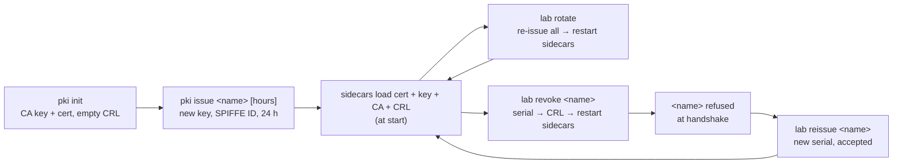

# Data flow

> Structure: [architecture.md](architecture.md) · production: [production.md](production.md).

## 1. A call from admin to orders, which calls users

```mermaid
sequenceDiagram
    autonumber
    participant C as client (admin cert)
    participant OE as orders sidecar :8443
    participant OA as orders-app :8000
    participant OX as orders sidecar :9001 (egress)
    participant UE as users sidecar :8443
    participant UA as users-app :8000

    C->>OE: TLS ClientHello
    OE-->>C: server cert (spiffe://lab.local/orders) + "send me YOUR cert"
    C->>OE: client cert (spiffe://lab.local/admin) + proof of key
    OE->>OE: chains to lab CA? on CRL? URI starts with spiffe://lab.local/?
    C->>OE: POST /orders/ (any x-forwarded-client-cert from the client is dropped)
    OE->>OA: POST /orders/ + XFCC: By=…/orders;Hash=…;URI=spiffe://lab.local/admin
    OA->>OA: require_caller("admin") ✓
    OA->>OX: GET http://127.0.0.1:9001/users/1 (plain HTTP, local)
    OX->>UE: TLS: presents spiffe://lab.local/orders
    UE-->>OX: presents spiffe://lab.local/users. OX accepts ONLY this exact ID
    UE->>UE: verify orders cert (CA, CRL, trust domain)
    UE->>UA: GET /users/1 + XFCC: …;URI=spiffe://lab.local/orders
    UA->>UA: require_caller("orders","admin","reporting") ✓
    UA-->>OA: 200 {"username":"carol"}
    OA-->>C: 201 order
```

Points to notice:
- **Steps 1–4 happen before any HTTP.** A missing, foreign or revoked certificate never produces an HTTP status; the TLS handshake fails, so the client sees a connection error.
- **Step 6:** the app learns the caller only from the header the sidecar **wrote**.
- **Steps 9–10:** orders calls users **as orders**, not as admin. The original caller isn't passed downstream. If users needed to know the end user, you'd add a propagated, signed token (e.g. a JWT); the mTLS identity is the *calling service*.

## 2. Where each kind of request fails

(Alerts and stats observed in this lab with Envoy 1.37.)

| Caller presents | Fails at | Client sees | Sidecar stat |
|---|---|---|---|
| no certificate | TLS handshake | `TLSV13_ALERT_CERTIFICATE_REQUIRED` (connection error) | `ssl.fail_verify_no_cert` |
| certificate from another CA | TLS handshake | connection error, alert `UNKNOWN_CA` | `ssl.fail_verify_error` |
| revoked certificate (after sidecar reload) | TLS handshake | connection error (handshake rejected) | `ssl.fail_verify_error` |
| expired certificate | TLS handshake | connection error, alert `CERTIFICATE_EXPIRED` | `ssl.fail_verify_error` |
| valid lab certificate, identity not allowed | app (`require_caller`) | **HTTP 403** `'<name>' is not allowed …` | — |
| valid certificate + forged XFCC header | header replaced by the sidecar | treated as its **real** identity | — |
| plain HTTP straight to `app:8000` | network | connection refused (app bound to 127.0.0.1) | — |
| orders' sidecar reaches a server with the wrong SPIFFE ID | egress TLS handshake | orders returns **502** (`CERTIFICATE_VERIFY_FAILED`) | `cluster.users_mtls.ssl.fail_verify_san` |

## 3. Certificate lifecycle



- **Issue:** each issue creates a **new key**, not just a new certificate, so a leaked old key is useless after rotation.
- **Revoke:** puts the certificate's **serial** on the CRL; other certificates for the same name aren't affected. That's why `reissue` works right away.
- **Reload:** Envoy reads files at start, so the lab restarts the sidecars. Meshes push new certificates over **SDS** without a restart ([production.md](production.md)).

## 4. Identity header format

Envoy writes (one element per proxy hop; `SANITIZE_SET` leaves exactly one):
```
x-forwarded-client-cert: By=spiffe://lab.local/users;Hash=<sha256 of caller cert>;URI=spiffe://lab.local/orders
```
- `By`: the identity of the sidecar that verified the caller (the receiving service).
- `Hash`: SHA-256 of the caller's certificate. Changes on every re-issue; `/whoami` returns it.
- `URI`: the caller's SPIFFE ID. **This is what `caller_identity` uses.**
