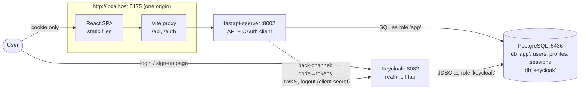
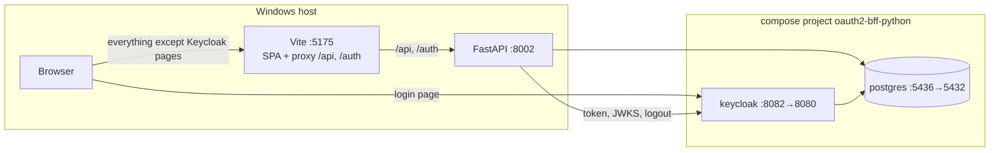

# Architecture

> Scope: the `fastapi-seerver` service, which is both the business API **and the OAuth 2.0 client** (backend-for-frontend), and Keycloak.
> Companion docs: [datamodel.md](datamodel.md) (tables, sessions), [dataflow.md](dataflow.md) (login, requests, logout) and [deployment.md](deployment.md) (target production design).
> Status: **learning lab**. Settings marked *lab-only* below must change before anything real runs on this.
> Sibling labs: `../../../keycloak-jwt-python/` (the SPA holds a JWT) and `../../../keykloak-python/` (Kerberos). Same app, different auth.

## 1. Purpose

The same users/profiles website, secured with the **Backend-for-Frontend (BFF)** pattern for OAuth 2.0:

- The **FastAPI backend is the OAuth client.** It's *confidential*: it holds a client secret and uses PKCE as well. It runs the authorization-code flow with Keycloak and verifies the ID token.
- It then keeps a **server-side session** in Postgres and gives the browser only an **opaque, HttpOnly cookie**.
- **No token ever reaches JavaScript**: no access, refresh or ID token in the SPA, in `localStorage` or in memory.

This is the architecture the IETF *OAuth 2.0 for Browser-Based Applications* guidance recommends for SPAs that have a backend. Code injected into the page (XSS) can't steal a token, because there's none to steal.

Like the other labs: **guests can read**, **writes need a login**, and the SPA's **Sign in** menu offers **Log in** and **Register** (both Keycloak pages).

| | `keycloak-jwt-python` (SPA client) | **this lab (BFF)** |
|---|---|---|
| Who is the OAuth client | the browser (public, keycloak-js) | **the backend** (confidential: secret + PKCE) |
| What the browser holds | access token in JS memory | **HttpOnly session cookie** only |
| How the API authenticates a request | `Authorization: Bearer <JWT>`, checked with JWKS | **cookie → session row** in Postgres |
| CSRF | not applicable (no cookies) | **needed**: SameSite=Lax + `X-CSRF: 1` on writes |
| CORS | required (SPA :5174 → API :8001) | **none**: same origin via the Vite proxy / ingress |
| Logout | Keycloak front-channel redirect | session row deleted + Keycloak **back-channel** logout |
| Revocation | token valid until `exp` | **immediate**: delete the session row |

## 2. System context



| Component | Responsibility | Trusts |
|---|---|---|
| **Keycloak** (`../../keycloak/`) | Identity provider: login and sign-up pages, passwords, its own SSO session; issues tokens **to the backend only** | the `bff` client, by its secret |
| **fastapi-seerver** | Business API **and** OAuth client: login, callback, sessions, logout, CSRF checks | Keycloak's signed ID token (JWKS), once per login |
| **PostgreSQL** (`../../postgres/`) | `app` (users, profiles, **sessions**) and `keycloak`, isolated roles (D13) | n/a |
| **React SPA** (`../../frontend/`) | UI. Calls `/api` with the cookie and `X-CSRF` on writes; navigates to `/auth/*` for login, register and logout | nothing; holds no secret and no token |
| **Vite proxy** (dev) / ingress (prod) | Puts SPA, `/api` and `/auth` on **one origin** | n/a |

## 3. Service internals

### 3.1 Layering

```
app/
├── main.py           composition root: /api routers, /auth router, /health, /api/me, 409 handler (no CORS)
├── config.py         settings from .env + oidc_url() (Keycloak endpoint URLs derived from the issuer)
├── dependencies.py   current_user (cookie → session), csrf_header, require_login
├── db.py             SQLAlchemy engine, session per request (get_db), declarative Base
├── routers/
│   ├── auth.py       OAuth 2.0 client: /auth/login, /auth/register, /auth/callback, /auth/logout
│   ├── users.py      CRUD (unchanged from the other labs), mounted at /api/users
│   └── profiles.py   CRUD (unchanged), mounted at /api/profiles
├── services/         users, profiles (unchanged) + sessions.py (create / get / delete, hashing, expiry)
└── models/           users, profiles (unchanged) + sessions.py (SessionRow)
migrations/versions/  0001 users+profiles, 0002 sessions
```

Rules (unchanged from the sibling labs, plus two new ones):
1. **`models` depend only on Pydantic, SQLAlchemy and `db.Base`.**
2. **`services` don't know about HTTP** and return `None`/`False` for "not found".
3. **`routers` don't run SQL.**
4. **Integrity in the database** (unique, FK, cascade), friendly errors in the app (409 handler, 404 pre-checks).
5. **Schema changes only through Alembic.**
6. **Reads are public; writes declare `dependencies=require_login`.** In this lab that means **session + CSRF header**.
7. **New: only `routers/auth.py` talks to Keycloak**, and only server-to-server (`httpx`). The browser reaches Keycloak only through top-level navigation to its login and sign-up pages.
8. **New: tokens never leave the backend.** No route returns a token, and the session table stores a refresh token only to end the Keycloak session at logout (D9).

### 3.2 Authentication components

**Per request** ([dependencies.py](../app/dependencies.py)):

| Check | How | Fails as |
|---|---|---|
| Session cookie present and known | cookie `bff_session` → `sha256(value)` → row in `sessions` | 401 `Not signed in` |
| Session not expired | `expires_at > now` (UTC) | 401 |
| Write comes from our own JS | header `X-CSRF: 1` (writes and `/auth/logout` only) | 403 `Missing X-CSRF header` |

`current_user` returns `{sub, preferred_username, email}` from the session row. No token is parsed per request: the identity was verified once, at login.

**Once per login** ([routers/auth.py](../app/routers/auth.py), `/auth/callback`):

| Check | Why | Fails as |
|---|---|---|
| `bff_tx` cookie has a valid HMAC and isn't older than 10 min | the transaction was started by us, recently | 400 |
| `state` = the one we sent | callback CSRF: an attacker can't inject their own `code` | 400 |
| code exchange succeeds with **client secret + PKCE verifier** | only this backend can redeem the code | 400 |
| ID token: RS256 signature (JWKS), `iss`, `aud = bff`, `exp`, `iat`, `sub` required | the token is real and meant for us | 400 |
| ID token `nonce` = the one we sent | binds the token to *this* login (no replay) | 400 |
| `next` is a relative path | no open redirect after login | silently becomes `/` |

### 3.3 Configuration

`.env`, read into `settings` in [config.py](../app/config.py):

| Variable | Default | Notes |
|---|---|---|
| `KEYCLOAK_ISSUER` | `http://localhost:8082/realms/bff-lab` | token, logout and JWKS URLs are derived from it (`oidc_url()`). Must equal the ID token's `iss`, which Keycloak derives from `KC_HOSTNAME` |
| `OIDC_CLIENT_ID` / `OIDC_CLIENT_SECRET` | `bff` / *(empty)* | must match client `bff` in `../../keycloak/bff-lab-realm.json` (lab secret `bff-lab-client-secret`) |
| `APP_URL` | `http://localhost:5175` | the public origin. Redirect URI = `APP_URL/auth/callback`, which must be registered in Keycloak |
| `SESSION_SECRET` | *random per process* | HMAC key for the `bff_tx` cookie. **Set it** so restarts and multiple instances agree |
| `SESSION_TTL_HOURS` | `8` | app session lifetime, independent of Keycloak's SSO session |
| `COOKIE_SECURE` | `false` | `true` behind HTTPS (browsers drop `Secure` cookies on plain http) |
| `DATABASE_URL` | `…@localhost:5436/app` | as in the other labs |

## 4. Deployment topology (lab)



- Runs **side by side** with the other labs: Keycloak 8082, realm `bff-lab`, API 8002, site 5175, Postgres 5436.
- The **realm** comes from `../../keycloak/bff-lab-realm.json`: the confidential client `bff` (secret, PKCE S256, redirect URI `http://localhost:5175/auth/callback`), registration, login by username or email, and seeded `alice` / `alice123`. It's imported on the first start only.
- **The redirect URI points at the Vite origin**, not at FastAPI's port. Keycloak sends the browser back to the site, the proxy forwards `/auth/callback`, and the session cookie is set for the site's origin.
- Setup: [scripts/setup-local-dev.ps1](../scripts/setup-local-dev.ps1) (no admin rights), or step by step in `../../GETTING-STARTED.md`.

## 5. Key decisions

| # | Decision | Why | Cost, and when to revisit |
|---|---|---|---|
| D1 | **BFF: the backend is the OAuth client; the browser gets only a session cookie** | Tokens are out of reach of XSS. Revocation is instant (delete the row). The SPA needs no OAuth library. Recommended by the IETF browser-apps BCP | The backend is now stateful (session store) and must be same-origin with the SPA. Each extra API the SPA needs goes **through** the BFF |
| D2 | **Server-side sessions in Postgres, keyed by `sha256(cookie)`** | Reuses the existing database, survives restarts, works with several instances. Hashing means a DB dump doesn't contain usable cookies | One indexed lookup per request. At high traffic use Redis with TTLs (deployment.md) |
| D3 | **Confidential client with client secret *and* PKCE** | The secret authenticates the backend to Keycloak. PKCE still protects the code (OAuth 2.1 requires it for all clients) | The secret must be protected and rotated (secrets manager). Upgrade path: `private_key_jwt` client authentication (no shared secret) |
| D4 | **One origin for SPA, `/api` and `/auth`** (Vite proxy in dev, ingress in prod) | First-party cookies, `SameSite=Lax` works, **no CORS** to configure or get wrong | Frontend and backend must be deployed behind the same host. Cross-domain SPAs can't use this as-is |
| D5 | **CSRF: SameSite=Lax + a required `X-CSRF: 1` header on every write and on logout** | Cookies are sent automatically, so a write must prove it came from our JS. Forms can't set custom headers; cross-origin `fetch` would need CORS, which is off | One header to remember in the client (`apiFetch` adds it). Token-based CSRF (double submit) is the alternative if CORS is ever enabled |
| D6 | **Login transaction in an HMAC-signed short-lived cookie** (`bff_tx`, path `/auth`, 10 min) | Stateless across the redirect round-trip: no DB row for half-finished logins. Stdlib `hmac`, no extra dependency | Not encrypted (holds `state`, `nonce` and the PKCE verifier, which are worthless after the callback). Needs a shared `SESSION_SECRET` across instances |
| D7 | **Validate the ID token once at login; no per-request JWT checks** | The session row is the source of truth after login; requests are a single DB lookup | Changes in Keycloak (user disabled) don't affect live sessions until they expire (8 h). Shorten the TTL or add back-channel logout from Keycloak if needed |
| D8 | **Back-channel logout with the stored refresh token** | Ends the Keycloak SSO session **without sending any token to the browser**. The usual `id_token_hint` front-channel redirect would expose the ID token in a URL. Verified: after logout, Keycloak shows the password form again | A refresh token sits in the DB (plain text in the lab, encrypt at rest in production). If it has already expired, Keycloak's session simply ends on its own idle timeout |
| D9 | **Login and registration are Keycloak pages**; the backend just starts the flow (`/auth/login`, `/auth/register`) | No credential handling in the app; password policy, MFA, reset and email verification are Keycloak settings | Keycloak's look, unless themed |
| D10 | **Same CRUD code as the other labs, mounted under `/api`** | Only the auth layer changes, which is the point of the comparison | Paths differ from the other labs (`/api/users/` vs `/users/`) |
| D11 | **PostgreSQL + SQLAlchemy 2.0 (sync) + psycopg 3 + Alembic** | As in the other labs; sessions are just another table (migration 0002) | Tests use SQLite; Postgres specifics are covered by the live checks |
| D12 | **Database location by configuration only** | Docker by default, installed Postgres or RDS via `.env` | Two URLs to keep in sync |
| D13 | **One server, two databases, least-privilege roles** | The API can't read Keycloak's tables and vice versa | Shared capacity and backups |

## 6. Known gaps and risks

1. **Authentication without authorization.** Any signed-in account can edit or delete any record. The session has `sub` and could carry roles; nothing checks them. *Fix:* store roles from the ID token in the session, add `require_role()` and ownership by `sub`.
2. **Refresh tokens stored in plain text** (`sessions.refresh_token`). *Fix:* encrypt at rest (Fernet with a KMS-held key), or drop it and accept front-channel logout.
3. **Session lifetime is independent of Keycloak.** A user disabled in Keycloak keeps their app session for up to `SESSION_TTL_HOURS`. *Fix:* shorter TTL, sliding expiry with a refresh-token check, or Keycloak back-channel logout notifications to `/auth/backchannel-logout`.
4. **No session rotation or listing.** The session id doesn't change on privilege changes, and users can't see or revoke their other sessions. The hashed key makes both easy to add.
5. **Expired sessions are purged only when someone logs in.** Fine at lab scale. *Fix:* a periodic cleanup job, or Redis TTLs.
6. **`SESSION_SECRET` defaults to a random value per process.** Two instances (or a restart mid-login) would reject each other's login transactions. Set it in `.env` / the secrets manager.
7. **`COOKIE_SECURE=false`** and plain HTTP: lab-only. Production must use HTTPS with `Secure` cookies (and can then use the `__Host-` cookie prefix).
8. **Public reads expose every email address**, with no paging or rate limit (as in the other labs).
9. **Lab-only settings:** the client secret in the realm JSON, `admin/admin`, seeded `alice`, `start-dev`, DB passwords in `.env`, no email verification on sign-up.
10. **Two dependency manifests, nothing pinned**, and **no observability** (no `/ready`, no structured logs). Same as the other labs.

## 7. Testing strategy

| Level | What | Where |
|---|---|---|
| Auth (unit) | Public reads vs 401 writes; cookie + missing/wrong `X-CSRF` → 403; forged and expired sessions → 401; logout is CSRF-protected, deletes the row, calls Keycloak's logout with the refresh token, and a replayed cookie → 401; tamper-proof tx cookie; **full callback with the token endpoint and JWKS mocked** (local RSA key): PKCE verifier and secret sent, HttpOnly + SameSite cookie, **no token in the response**; bad state, nonce, audience, failed exchange or missing tx → 400; open redirects blocked | [tests/test_auth.py](../tests/test_auth.py) (8 tests) |
| CRUD | lifecycle, cascade, 404s, 409 with rollback, under `/api` with the CSRF header | [tests/test_crud.py](../tests/test_crud.py) |
| Frontend | `SignInMenu`: Log in / Register navigate to `/auth/*`; Log out POSTs with `X-CSRF`; `UserForm` as before | `../../frontend/src/**/*.test.tsx` |
| End-to-end (scripted, by hand) | curl + cookie jar through the **Vite proxy**: login → callback → cookie; no JWT in any browser-facing response; DB holds hashes; CRUD with cookie and CSRF; logout → replay 401 → Keycloak shows the password form again; email login; registration; open-redirect guard | not in the repo yet |

## 8. Evolution path

1. Authorization (roles in the session, ownership by `sub`): gap 1.
2. Encrypt refresh tokens at rest, or drop them (gap 2); sliding sessions plus Keycloak back-channel logout notifications (gap 3).
3. Production deployment ([deployment.md](deployment.md)): one ingress host for SPA, `/api` and `/auth`; HTTPS with `Secure` cookies; secrets in a secrets manager; Redis for sessions at scale.
4. Observability and a `/ready` probe.
