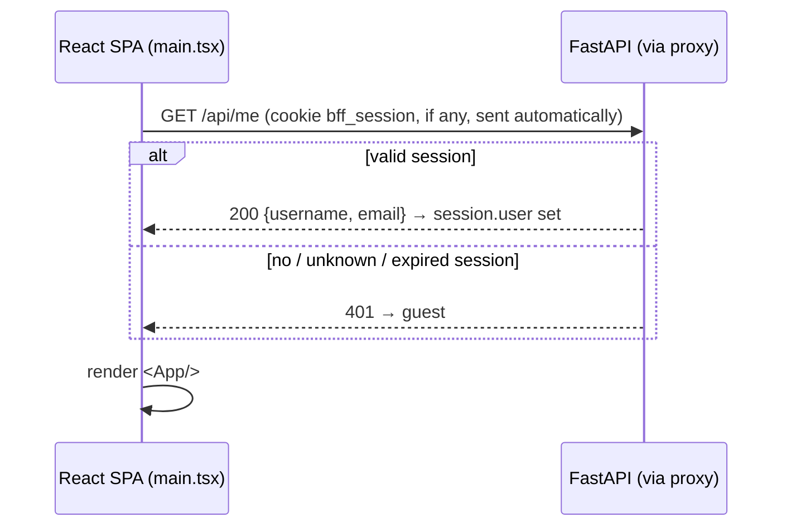
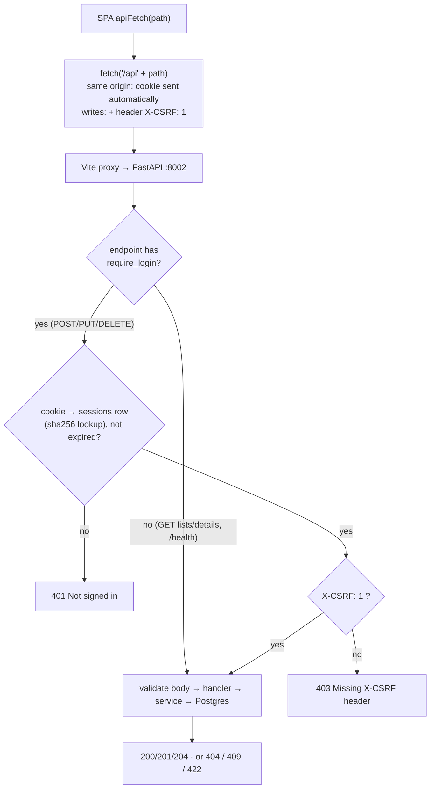
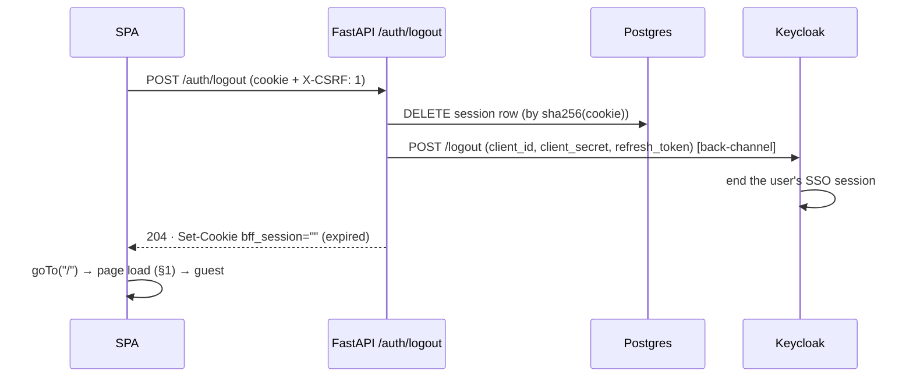

# Data flow

> How data and credentials move, step by step, including failure paths.
> Structure: [architecture.md](architecture.md) · tables and sessions: [datamodel.md](datamodel.md).

The browser only ever talks to **one origin, `http://localhost:5175`**, plus Keycloak's pages during login. Vite serves the SPA and forwards `/api/*` and `/auth/*` to FastAPI on `:8002` (an ingress does the same in production).

| Flow | When |
|---|---|
| [1. Page load](#1-page-load-who-is-signed-in) | every full page load |
| [2. Log in (OAuth 2.0 code flow, BFF)](#2-log-in-oauth-20-authorization-code-flow-bff) | Sign in → Log in |
| [3. Register](#3-register) | Sign in → Register |
| [4. API request: cookie + CSRF](#4-api-request-cookie--csrf) | every API call |
| [5. CRUD flows](#5-crud-flows) | create / update / delete |
| [6. Log out](#6-log-out) | Log out |
| [7. Signing keys](#7-signing-keys-jwks) | first login, key rotation |
| [8. Same origin, no CORS](#8-same-origin-no-cors) | always |
| [9. Error reference](#9-error-reference) | all |

## 1. Page load: who is signed in?



No Keycloak round trip on page load, and no token in the page. Being signed in **is** having a valid session row.

## 2. Log in: OAuth 2.0 authorization-code flow, BFF

`SignInMenu` → **Log in** → `goTo("/auth/login")`, a full-page navigation:

```mermaid
sequenceDiagram
    autonumber
    actor U as User
    participant B as Browser
    participant BFF as FastAPI /auth (via proxy)
    participant KC as Keycloak :8082
    participant DB as Postgres (sessions)

    B->>BFF: GET /auth/login?next=/
    BFF->>BFF: state, nonce, PKCE verifier (+ S256 challenge)
    BFF-->>B: 302 → KC /auth?client_id=bff&state&nonce&code_challenge…<br/>Set-Cookie bff_tx=<signed {state,nonce,verifier,next}> (HttpOnly, path /auth, 10 min)
    B->>KC: GET login page
    U->>KC: username or email + password
    KC-->>B: 302 → http://localhost:5175/auth/callback?code&state
    B->>BFF: GET /auth/callback?code&state  (+ bff_tx cookie)
    BFF->>BFF: verify bff_tx HMAC + age; state matches?
    BFF->>KC: POST /token (code, client_secret, code_verifier, redirect_uri)  [back-channel]
    KC-->>BFF: id_token, access_token, refresh_token
    BFF->>KC: GET /certs (JWKS, cached)
    BFF->>BFF: verify id_token: RS256, iss, aud=bff, exp/iat/sub, nonce
    BFF->>DB: INSERT session (sha256(cookie), sub, username, email, refresh_token, expires_at)
    BFF-->>B: 302 → next  ·  Set-Cookie bff_session=<random> (HttpOnly, SameSite=Lax)  ·  bff_tx deleted
```

What each piece protects against:

| Mechanism | Stops |
|---|---|
| `state` (checked against the signed tx cookie) | login CSRF: an attacker making your browser finish *their* login |
| PKCE (`code_challenge` / `code_verifier`) | a stolen authorization code being redeemed by someone else |
| client secret at the token endpoint | anyone but this backend redeeming the code |
| `nonce` in the ID token | replaying an old ID token into a new login |
| HMAC on `bff_tx` | tampering with `next` or the verifier between redirects |
| `safe_next()` | open redirects (`next=https://evil.example` → `/`) |

**What the browser sees:** two cookies (`bff_tx` briefly, then `bff_session`) and redirects. **Never a token.** That was verified live: no `eyJ…` (JWT) in any browser-facing response.

## 3. Register

`SignInMenu` → **Register** → `goTo("/auth/register")`. Identical to §2, except step 3 redirects to Keycloak's `/protocol/openid-connect/registrations` (the sign-up page). After a successful sign-up Keycloak continues the same flow: callback, session, cookie. The new user lands back on the site already signed in. Duplicate usernames or emails are refused on Keycloak's page.

## 4. API request: cookie + CSRF



- `/api/me` uses `current_user` only (no CSRF needed for a read).
- **Why the header beats CSRF:** the browser attaches `bff_session` to *any* request to this origin, including one triggered by another site. A cross-site `<form>` can't add custom headers, and a cross-site `fetch` with a custom header needs a CORS preflight that this backend never approves (no CORS middleware). `SameSite=Lax` already blocks cross-site POSTs in modern browsers; the header is the second layer.
- Order: no session → **401** before the CSRF check → **403**.

## 5. CRUD flows

Same as the sibling labs (create → reload list; update = full `PUT`; delete user → `ON DELETE CASCADE` removes their profiles), with two differences on the wire:
- paths are under **`/api`** (`/api/users/`, `/api/profiles/`);
- authentication is the **cookie**, and every write carries **`X-CSRF: 1`** (added by `apiFetch`).

## 6. Log out



- **Revocation is immediate.** The row is gone, so even a copied cookie gets **401** (verified by replaying the old cookie).
- **Keycloak's session ends too, without a browser redirect.** Verified: the next *Log in* shows the password form instead of signing straight back in. The usual alternative (redirecting the browser to Keycloak's logout with `id_token_hint`) would put the ID token in a URL, which this design avoids.
- If Keycloak is unreachable, the app session is still deleted and Keycloak's session expires on its own idle timeout.
- Logout requires `X-CSRF` too, so another site can't force a logout.

## 7. Signing keys (JWKS)

Used **once per login**, to verify the ID token (`routers/auth.py` → `PyJWKClient`): the key set is cached for 5 min, and an unknown `kid` forces a refresh at most once per 30 s. Unlike the JWT lab, **normal API requests never touch JWKS**, because they're session lookups.

## 8. Same origin, no CORS

| Request from the page | Goes to | Same origin? |
|---|---|---|
| page, JS, CSS | `localhost:5175` (Vite) | yes |
| `/api/*`, `/auth/*` | `localhost:5175` → proxied to `:8002` | **yes**, so the cookie is first-party and there's no preflight |
| login and sign-up pages | `localhost:8082` (Keycloak) | no, but it's a **top-level navigation**, not a `fetch`, so no CORS is involved |

FastAPI has **no CORS middleware**. A cross-origin `fetch` to it fails, which is part of the CSRF defence (§4).

## 9. Error reference

| Status | Where | Body / effect | Typical cause |
|---|---|---|---|
| 302 | `/auth/login`, `/auth/register`, `/auth/callback` | redirect | normal flow |
| 400 | `/auth/callback` | `{"detail": "Invalid or expired login, please try again"}` | `state` mismatch, tx cookie missing, tampered or older than 10 min (e.g. the callback opened in another browser) |
| 400 | `/auth/callback` | `Code exchange with Keycloak failed` | wrong `OIDC_CLIENT_SECRET`, code already used, `redirect_uri` mismatch |
| 400 | `/auth/callback` | `Invalid ID token: …` / `ID token nonce mismatch` | wrong `KEYCLOAK_ISSUER`, wrong client id, replayed token |
| 400 | `/auth/callback?error=…` | `Login failed: <error>` | user cancelled on Keycloak's page, or Keycloak rejected the request |
| 401 | `/api/*` writes, `/api/me` | `{"detail": "Not signed in"}` | no cookie, unknown or expired session, logged out |
| 403 | `/api/*` writes, `/auth/logout` | `{"detail": "Missing X-CSRF header"}` | a client (e.g. curl, a custom script) didn't send `X-CSRF: 1` |
| 404 / 409 / 422 | `/api/*` | as in the sibling labs | unknown id / duplicate username or email / invalid body |
| 204 | `DELETE`, `/auth/logout` | empty | success |

Keycloak-side messages (on Keycloak's pages): "Invalid username or password."; "Username already exists" / "Email already exists"; **"Invalid parameter: redirect_uri"** means the site isn't on `http://localhost:5175`, or `APP_URL` doesn't match the redirect URI registered for client `bff`.
