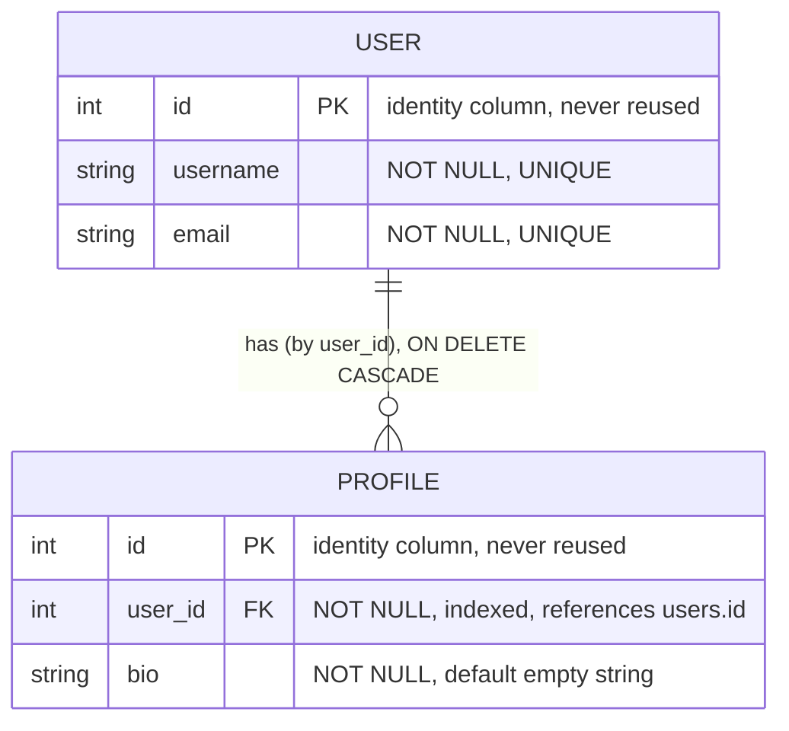
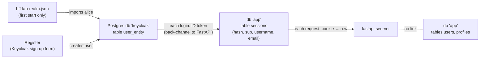

# Data model

> What data this service owns, what it only reads, and the rules on it.
> Context: [architecture.md](architecture.md) · request paths: [dataflow.md](dataflow.md).

The service deals with two separate kinds of data:

- **Application data** it *owns*: `User` and `Profile`, tables in PostgreSQL database `app`.
- **Identity data**, verified once at login from Keycloak's **ID token** and then kept in a server-side **session** row (§1.4). The single source of truth is **Keycloak's own database**: the seeded demo user `alice` and everyone who signs up through *Register*.

- **Sessions** it owns too: one row per signed-in browser (table `sessions`).

The most important fact about the current model: **these two aren't linked** (see [§4](#4-identity-vs-application-data)).

## 1. Application entities



### 1.1 `User`: [models/users.py](../app/models/users.py)

| Field | Type | Set by | Rules |
|---|---|---|---|
| `id` | `int` | server (Postgres identity) | Increasing, **never reused** after a delete. Never sent by the client (it's in the URL for `PUT`/`DELETE`) |
| `username` | `str` | client | Required, **unique** (DB constraint → 409). No length limit |
| `email` | `EmailStr` | client | **Unique** (DB constraint → 409). Must look like a valid address (`email-validator`, no DNS check). **Reserved names like `.local`, `.test` and `.localhost` are rejected.** So `carol@lab.local` fails here. Keycloak's own email rules are separate, so a Keycloak account's email in the token is never checked by this rule |

### 1.2 `Profile`: [models/profiles.py](../app/models/profiles.py)

| Field | Type | Set by | Rules |
|---|---|---|---|
| `id` | `int` | server (Postgres identity) | Increasing, never reused, its own sequence |
| `user_id` | `int` | client | Must point to an existing `User` **on create and on update**: the router pre-checks for a clear 404, and the foreign key guarantees it. An update can move a profile to another user |
| `bio` | `str` | client | Optional, defaults to `""`, no length limit |

Relationship: **one user, many profiles**. **Deleting a user deletes their profiles**, done by Postgres (`ON DELETE CASCADE`), not by app code. Nothing stops a second profile for the same user. If the intended design is one profile per user, that rule is missing (see [§5](#5-invariants-and-gaps)).

### 1.3 Operations

| | Users | Profiles | Auth |
|---|---|---|---|
| List | `GET /api/users/` | `GET /api/profiles/?user_id=` (filter optional) | public |
| Read | `GET /api/users/{id}` | `GET /api/profiles/{id}` | public |
| Create | `POST /api/users/` → 201, **409** on duplicate username/email | `POST /api/profiles/` → 201, 404 if user missing | login + `X-CSRF` |
| Update | `PUT /api/users/{id}` (full replace), 409 on duplicate | `PUT /api/profiles/{id}` (full replace), 404 if profile or user missing | login + `X-CSRF` |
| Delete | `DELETE /api/users/{id}` → 204, **cascades** | `DELETE /api/profiles/{id}` → 204 | login + `X-CSRF` |

"Login" here means a valid `bff_session` cookie; writes also need the `X-CSRF: 1` header (403 without it).

### 1.4 `Session`: [models/sessions.py](../app/models/sessions.py)

One row per signed-in browser, created by `/auth/callback` after the ID token is verified ([services/sessions.py](../app/services/sessions.py)).

| Column | Type | Content | Notes |
|---|---|---|---|
| `id` | `VARCHAR(64)` PK | **SHA-256 (hex) of the cookie value** | the cookie itself (`secrets.token_urlsafe(32)`, 256 bits) is never stored, so a DB dump can't be replayed as cookies |
| `sub` | `VARCHAR` | Keycloak user id (ID token `sub`) | stable identity key; not used for authorization yet |
| `username` | `VARCHAR` | ID token `preferred_username` (falls back to `sub`) | returned by `/api/me` |
| `email` | `VARCHAR NULL` | ID token `email` | returned by `/api/me` |
| `refresh_token` | `TEXT NULL` | Keycloak refresh token | **only** used to end the Keycloak session at logout (back-channel). Never sent to the browser. Plain text in the lab: encrypt at rest in production |
| `created_at` | `TIMESTAMP` | login time, UTC (naive) | |
| `expires_at` | `TIMESTAMP`, indexed | `created_at + SESSION_TTL_HOURS` (8 h) | requests after it get 401; rows past it are deleted whenever a new session is created |

No access token and no ID token is stored: after login, the session row *is* the proof of identity. Not related to `users`: an app `User` is CRUD data, a session is a logged-in Keycloak account (§4).

## 2. Schema pattern: separate input and output models

Each entity file in `app/models/` holds **one table class and two Pydantic classes**:

```
UserRow (SQLAlchemy table "users")        ← only services touch it
User (output)  ──inherits from──►  UserCreate (input)     User = UserCreate fields + id, from_attributes=True
ProfileRow / ProfileCreate / Profile        (same pattern)
```

Services convert rows to the output model (`User.model_validate(row)`), so **ORM objects never leave the service layer**. Routers and the API contract don't change if the table gains internal columns.

- **`*Create`** is what the client may send, so a client **can't choose `id`**: extra fields are ignored (Pydantic's default `extra="ignore"`).
- **The `*` read model** is what the API returns (the stored form is the `*Row` table class). Routers declare it as `response_model`, so output is filtered through the schema even if the stored object later gains internal fields.
- Inheritance keeps the two in sync. The trade-off: once read and write fields differ (e.g. `password` on create only, `created_at` on read only), switch to a shared `*Base` plus separate `*Create`/`*Read`/`*Update` classes rather than piling on overrides.

**Updates are full replacements** (`PUT`) that reuse the `*Create` model: the client sends every field. There's no `PATCH` and no `*Update` model with optional fields. Add them when a client needs to change one field without knowing the others.

The frontend copies these types by hand in `../../frontend/src/users/types.ts` and `../../frontend/src/profiles/types.ts` (`X`, `XCreate = Omit<X, "id">`). **That's a second copy of the contract.** Generate it from `/openapi.json` (e.g. `openapi-typescript`) once the API grows past a couple of models.

## 3. Storage

PostgreSQL database **`app`**, owned by role **`app`** ([db.py](../app/db.py), [services/users.py](../app/services/users.py), [services/profiles.py](../app/services/profiles.py)). The schema is defined by migrations in [migrations/versions/](../migrations/versions/).

| Property | Behaviour | Notes |
|---|---|---|
| Durability | Postgres (Docker volume `pg-data`, or your server/RDS) | Survives API restarts, `fastapi dev` reloads, container recreates. Verified: data written, FastAPI stopped and started, data still there |
| Scope | Shared by all API processes | Several workers or pods see the same data |
| Sessions | One SQLAlchemy `Session` per request (`get_db`); services `commit()` | A failed write (e.g. a unique violation) is rolled back when the session closes; the next request is unaffected |
| ID generation | `GENERATED BY DEFAULT AS IDENTITY` | Unique under concurrency, never reused, survives restarts |
| Uniqueness | `UNIQUE(username)`, `UNIQUE(email)` | Violation → `IntegrityError` → **409** (handler in `main.py`) |
| Referential integrity | `profiles.user_id REFERENCES users(id) ON DELETE CASCADE`, indexed | Router pre-checks give a clear 404; the FK catches races. The index makes `?user_id=` and the cascade fast |
| Listing | `ORDER BY id` | No paging yet; add `limit`/`offset` (or keyset) when lists grow |
| Update | load row → set fields → commit | Last write wins; no optimistic locking (`ETag`/version column) |
| Connections | `create_engine(..., pool_pre_ping=True)`, default pool (5 + 10 overflow) | Pre-ping drops dead connections after a DB restart or RDS idle timeout. Size the pool per instance against the server's `max_connections` |

The services expose a small, storage-neutral interface. Each function takes the request's `Session` first:
- **users:** `list_users`, `get_user`, `create_user`, `update_user`, `delete_user`;
- **profiles:** `list_profiles(user_id=None)`, `get_profile`, `create_profile`, `update_profile`, `delete_profile`.

"Not found" comes back as `None`/`False`, never an exception. Duplicates surface as `IntegrityError`, which `main.py` maps to 409.

**Tests** run the same services on a fresh **in-memory SQLite** database per test ([tests/conftest.py](../tests/conftest.py), with `PRAGMA foreign_keys=ON` so the cascade works). That keeps `pytest` fast and Docker-free. Postgres-specific behaviour (identity columns, real concurrency) is covered by the migration and the live checks.

## 4. Identity vs application data

Identity reaches the backend **once per login**, as an ID token from Keycloak's token endpoint (back-channel, never through the browser). It's verified, and four values are copied into the session row. After that, requests carry only the opaque cookie. Values below are from live logins: `alice` (seeded) and `frank3829` (registered).

| ID token claim | Checked at login | Kept in `sessions` | Example |
|---|---|---|---|
| `iss` | = `KEYCLOAK_ISSUER` | — | `http://localhost:8082/realms/bff-lab` |
| `aud` | = `bff` (the client id) | — | `bff` |
| `exp`, `iat` | required, not expired | — | about 5 min after issue (only matters at the moment of login) |
| `nonce` | = the nonce from the login transaction | — | random per login |
| `sub` | required | `sub` | Keycloak user UUID |
| `preferred_username` | — | `username` | `alice`, `frank3829` |
| `email` | — | `email` | `alice@example.com` |

The access token in the same response is **not used**: this backend is the resource itself, so it doesn't call other APIs on the user's behalf. The refresh token is kept only for logout.

Where identity data actually lives:



Keycloak enforces unique usernames and (with `duplicateEmailsAllowed: false`) unique emails across all its accounts. Users can log in with either.

**The gap:** `User` records are created from form input and have no reference to `sub`. Today:

- any signed-in account (alice, or someone who registered a minute ago) can create, edit or **delete** any `User` or `Profile`;
- nothing ties a record to the person who created it;
- if an account is deleted in Keycloak, its app data stays and nobody owns it.

Both live in the same Postgres server but in **separate databases with separate roles**. The API's role can't even connect to Keycloak's database, so the link has to come from the session's `sub` (copied from the ID token), never from a cross-database join.

**Recommended model**, best added in the next migration while the tables are still small:

| Field | Purpose |
|---|---|
| `User.subject` (`str`, unique) | `claims["sub"]`. Stable identity key. Use `sub`, not `preferred_username`, because usernames can be renamed and `sub` can't |
| `User.username`, `User.email` | copied from claims on first request ("just-in-time provisioning"), not typed into a form. Or drop them and read them from the token |
| `Profile.user_id` + unique constraint | if one profile per user is intended |
| `owner` checks | compare `claims["sub"]` with the resource's `subject` in the service layer |

## 5. Invariants and gaps

| Rule | Enforced? | Where / gap |
|---|---|---|
| `email` is a valid address | ✅ | Pydantic `EmailStr` → 422 |
| Client can't set `id` | ✅ | `*Create` models have no `id` |
| `Profile.user_id` points to an existing user | ✅ | foreign key; router pre-check for a clear 404 |
| No profiles left for a deleted user | ✅ | `ON DELETE CASCADE` |
| `id` unique, never reused | ✅ | identity columns |
| `username` unique | ✅ | `UNIQUE` constraint → 409; tested in `tests/test_crud.py` |
| `email` unique | ✅ | `UNIQUE` constraint → 409 (case-sensitive: `A@x.com` ≠ `a@x.com`) |
| Only signed-in users change data | ✅ | `require_login` (session cookie + `X-CSRF`) on every write; 401/403 asserted in `tests/test_auth.py` |
| A session cookie can't be guessed or recovered from the DB | ✅ | 256-bit random value; only its SHA-256 is stored |
| Expired sessions don't work | ✅ | `expires_at` checked on every request (tested) |
| Expired session rows are removed | ⚠️ | only when someone logs in (no periodic job) |
| Only the **owner** changes a record | ❌ | no ownership model (§4) |
| One profile per user | ❌ | none, if intended (`UNIQUE(user_id)`) |
| Field lengths limited | ❌ | `VARCHAR` without length, `str` without `max_length`. An unlimited `bio` lets a client store megabytes |
| App data tied to the identity that created it | ❌ | §4 |

## 6. Schema and migrations

The schema lives in [migrations/versions/](../migrations/versions/): `0001_create_users_and_profiles.py`, then `0002_create_sessions.py` (head). The resulting tables:

```sql
CREATE TABLE users (
    id       INTEGER GENERATED BY DEFAULT AS IDENTITY PRIMARY KEY,
    username VARCHAR NOT NULL UNIQUE,
    email    VARCHAR NOT NULL UNIQUE
);
CREATE TABLE profiles (
    id      INTEGER GENERATED BY DEFAULT AS IDENTITY PRIMARY KEY,
    user_id INTEGER NOT NULL REFERENCES users(id) ON DELETE CASCADE,
    bio     VARCHAR NOT NULL DEFAULT ''
);
CREATE INDEX ix_profiles_user_id ON profiles (user_id);
CREATE TABLE sessions (
    id            VARCHAR(64) PRIMARY KEY,   -- sha256(cookie)
    sub           VARCHAR NOT NULL,
    username      VARCHAR NOT NULL,
    email         VARCHAR,
    refresh_token TEXT,
    created_at    TIMESTAMP NOT NULL,        -- UTC
    expires_at    TIMESTAMP NOT NULL         -- UTC
);
CREATE INDEX ix_sessions_expires_at ON sessions (expires_at);
```

Workflow for any change:

1. Edit the `*Row` class in `app/models/` (and the Pydantic schemas if the API changes).
2. `alembic revision --autogenerate -m "add subject to users"`, then **read the generated file**. Autogenerate misses renames (it sees drop + add) and needs hand-written data migrations.
3. `alembic upgrade head` locally. Commit the migration with the code.
4. Deploy: run `alembic upgrade head` **before** starting the new app version. For zero downtime, make changes backwards compatible (add a nullable column → backfill → make it NOT NULL in a later release).

Next migrations worth doing, from §4 and §5:
- `users.subject TEXT UNIQUE` (Keycloak `sub`), plus `created_at TIMESTAMPTZ DEFAULT now()` on both tables;
- length limits (`VARCHAR(…)` and matching `max_length` in Pydantic, so oversized input gets a 422, not a DB error);
- `UNIQUE(user_id)` on profiles if it's one per user;
- case-insensitive email uniqueness (`UNIQUE (lower(email))`).
