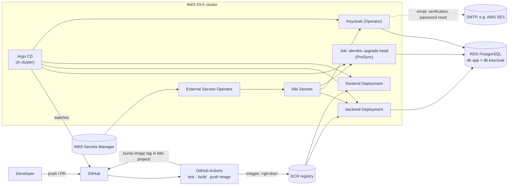

# Deployment: CI/CD, secrets and Kubernetes

> **Status: target design, not built yet.** Today everything runs on one Windows machine (see [architecture.md §4](architecture.md#4-deployment-topology-lab)).
> This document describes how the same system moves to production: **GitHub Actions** builds and ships it, a **secrets manager** holds its passwords, and **Kubernetes** runs it.
> Companion docs: [architecture.md](architecture.md) · [datamodel.md](datamodel.md) · [dataflow.md](dataflow.md).

## 1. Today vs. production

| Concern | Lab today | Production target |
|---|---|---|
| Build and test | by hand: `pytest`, `npm test`, `npm run build` | **GitHub Actions** on every pull request |
| Ship | `scripts/setup-local-dev.ps1` | GitHub Actions builds images → registry → **Argo CD** deploys |
| Run | `docker compose` + `fastapi dev` + `npm run dev` | **Kubernetes** (AWS EKS): Deployments, Services, Ingress |
| Passwords and keys | `.env` files (gitignored) | **AWS Secrets Manager** → External Secrets Operator → Kubernetes Secrets |
| One origin for SPA + `/api` + `/auth` | Vite dev proxy on :5175 | **one ingress host** with path routing (`/` → frontend, `/api` and `/auth` → backend) |
| Sessions | Postgres table `sessions` | Postgres is fine for moderate traffic; **Redis** (ElastiCache) with TTLs at scale |
| Cookies | `Secure` off (plain http) | HTTPS everywhere, `COOKIE_SECURE=true` (consider the `__Host-` cookie prefix) |
| Database | Postgres container on `:5436` | **AWS RDS** for PostgreSQL (already supported: change `DATABASE_URL`/`KC_DB_URL`) |
| User accounts | Keycloak's own database (seeded `alice` + self-registration) | still Keycloak's database; optionally federated with the company directory (LDAP/AD) or social logins, which is Keycloak config only (§6) |
| Keycloak | `start-dev`, plain HTTP | **Keycloak Operator**, production mode (`start`), TLS, 2+ replicas |
| TLS | none (`sslRequired: none`) | HTTPS everywhere: ingress with AWS ACM or cert-manager certificates |



## 2. Code changes required first

These block a production deployment. Each is small.

| # | Change | Why | Where |
|---|---|---|---|
| P1 | **`Dockerfile` for the backend** | CI needs an image. Run `fastapi run app/main.py` (uvicorn, no auto-reload) as a non-root user, behind the ingress with proxy headers | `fastapi-seerver/Dockerfile` |
| P2 | **`Dockerfile` for the frontend** | multi-stage: `npm ci && npm run build`, then nginx serving `dist/` | `frontend/Dockerfile` |
| P3 | **Same-origin routing in production** | the SPA calls relative `/api` and `/auth` (no URLs to configure, a BFF advantage), so the ingress must serve the frontend and route `/api` and `/auth` to the backend **on the same host**. The backend's `APP_URL` = that public origin, which is also the base of the redirect URI registered in Keycloak | ingress manifest, backend `APP_URL` |
| P4 | **`/ready` endpoint** | Kubernetes should only send traffic when the DB is reachable. `/health` stays a cheap liveness check; `/ready` runs `SELECT 1` | `app/main.py` |
| P5 | **Keycloak production config** | `start` instead of `start-dev`, a real hostname, TLS, `KC_PROXY_HEADERS=xforwarded`; the realm import job replaces `--import-realm`, and the realm (without the seeded `alice`) is managed by the Operator's `KeycloakRealmImport` or a config-as-code tool | Keycloak CR / `keycloak/` |
| P6 | **Production realm and client settings** | move the `bff` client secret out of the realm JSON into the secrets manager (or switch to `private_key_jwt`); redirect URI `https://app.example.com/auth/callback`; email verification on sign-up (needs SMTP), password policy, brute-force detection (§6) | `keycloak/bff-lab-realm.json` → prod realm config |
| P7 | **Pin dependency versions** | reproducible images. Use a lock file (`uv lock` / `pip-compile`) instead of unpinned `requirements.txt` | `fastapi-seerver/` |

## 3. GitHub Actions: CI/CD

### 3.1 What runs when

| Trigger | Job | Steps |
|---|---|---|
| Pull request touching `fastapi-seerver/**` | **backend-ci** | `pip install -r requirements.txt` → `pytest` (SQLite, no services needed) → `alembic upgrade head --sql` (renders the migration SQL as a check) |
| Pull request touching `frontend/**` | **frontend-ci** | `npm ci` → `npm test` → `npm run build` (strict `tsc`) |
| Push to `main` | **build-and-push** | build both images, tag them with the **git SHA**, push to ECR. Scan them (e.g. Trivy) |
| Push to `main`, after build | **deploy** | commit the new tag to `k8s-project/overlays/prod/kustomization.yaml`; Argo CD notices and syncs |

Path filters (`on.pull_request.paths`) keep a frontend-only change from running backend jobs, which matters in a monorepo.

### 3.2 Example: backend CI

`.github/workflows/backend-ci.yml` (repo root):
```yaml
name: backend-ci
on:
  pull_request:
    paths: ["auth/oauth2-bff-python/fastapi-seerver/**"]
jobs:
  test:
    runs-on: ubuntu-latest
    defaults:
      run:
        working-directory: auth/oauth2-bff-python/fastapi-seerver
    steps:
      - uses: actions/checkout@v4
      - uses: actions/setup-python@v5
        with: { python-version: "3.12", cache: pip }
      - run: pip install -r requirements.txt
      - run: pytest
```

### 3.3 How the pipeline reaches AWS

**No stored AWS keys.** GitHub Actions gets short-lived credentials through **OIDC**: an IAM role trusts `token.actions.githubusercontent.com` for this repository and branch, and the workflow uses `aws-actions/configure-aws-credentials` with `role-to-assume`. The role may only push to ECR. Argo CD does the deploying from inside the cluster, so CI never needs cluster-admin rights.

### 3.4 Rules
- **Branch protection on `main`:** CI must pass, plus at least one review.
- **Images are immutable:** tag by git SHA, never `latest`. Rolling back means pointing the tag back.
- **Migrations before code:** the migration Job runs as an Argo CD **PreSync** hook (`argocd.argoproj.io/hook: PreSync`). Write migrations backwards compatible (add nullable → backfill → enforce in a later release), so the old pods keep working during the rollout ([datamodel.md §6](datamodel.md#6-schema-and-migrations)).

## 4. Secrets management

### 4.1 Inventory

Everything below is in `.env` files or the repo today and must move:

| Secret | Used by | Lab today | Production store | Kubernetes Secret |
|---|---|---|---|---|
| `DATABASE_URL` (role `app` password) | backend, migration Job | `fastapi-seerver/.env`, and `APP_DB_PASSWORD` in the root `.env` (used to create the role) | Secrets Manager `prod/app/database` | `app-db` |
| Keycloak DB password (role `keycloak`) | Keycloak | `.env` `KEYCLOAK_DB_PASSWORD` | `prod/keycloak/database` | `keycloak-db` |
| Postgres admin / RDS master password | only `create-databases.sql`, by an operator | `.env` `POSTGRES_ADMIN_PASSWORD` | RDS-managed master secret | none (not given to apps) |
| Keycloak admin account | operators | `admin/admin` in `docker-compose.yml` | `prod/keycloak/admin`; better, an admin group in AD | `keycloak-admin` |
| Demo user password `alice123` | lab only | `keycloak/bff-lab-realm.json` | **remove**: no seeded users in production | none |
| SMTP credentials (for verification/reset mails) | Keycloak | not configured | `prod/keycloak/smtp` | `keycloak-smtp` |
| **`OIDC_CLIENT_SECRET`** (client `bff`) | backend | `fastapi-seerver/.env` **and** `keycloak/bff-lab-realm.json` | `prod/app/oidc-client` (rotate; same value set on the Keycloak client) | `app-oidc` |
| **`SESSION_SECRET`** (signs the login-transaction cookie) | backend, **identical on every replica** | `fastapi-seerver/.env` | `prod/app/session-secret` | `app-oidc` |
| Refresh tokens | backend | rows in `sessions` (plain text) | stay in the DB, **encrypted at rest** with a KMS-held key | n/a |

**Not secrets** (plain `ConfigMap`): `KEYCLOAK_ISSUER`, `OIDC_CLIENT_ID`, `APP_URL`, `SESSION_TTL_HOURS`, `COOKIE_SECURE`, the realm JSON (minus the client secret and any user passwords). Rule of thumb: if leaking it doesn't let someone in, it's config.

### 4.2 Two different secret stores

| | **GitHub Secrets / Variables** | **AWS Secrets Manager** |
|---|---|---|
| For | the **pipeline** | the **running application** |
| Holds | AWS account id, IAM role ARN to assume (via OIDC, not keys), registry name | database passwords, Keycloak admin, SMTP credentials |
| Read by | GitHub Actions jobs | pods, through External Secrets Operator |
| Never | runtime secrets (they'd end up in build logs or images) | CI credentials |

### 4.3 From the secrets manager to a pod

```
AWS Secrets Manager          External Secrets Operator           Kubernetes Secret          pod
"prod/app/database"   ──►    ExternalSecret (refresh 1h)   ──►   "app-db"            ──►   env DATABASE_URL
                             auth: IRSA (IAM role for its
                             service account, read-only)
```

- **The app code doesn't change.** It reads `DATABASE_URL` from the environment exactly as it does with `.env` today ([dependencies.py](../app/dependencies.py)).
- **Rotation:** rotate in Secrets Manager (RDS supports managed rotation). ESO updates the Secret, and a rollout restart (or Reloader) picks it up.
- Encrypt Kubernetes Secrets at rest with a KMS key (an EKS setting). Restrict `get secrets` with RBAC.

## 5. Kubernetes

### 5.1 Component mapping

| Component | Objects | Key settings |
|---|---|---|
| **backend** | `Deployment` (2+ replicas), `Service`, **paths `/api` and `/auth` on the app's ingress host** (`app.example.com`), `HorizontalPodAutoscaler`, `PodDisruptionBudget` | `envFrom`: ConfigMap `backend-config` + Secrets `app-db`, `app-oidc`. Sessions live in the DB, so any replica can serve any user (no sticky sessions). Liveness `/health`, readiness `/ready` (P4). CPU/memory requests and limits. Non-root, read-only root filesystem |
| **migrations** | `Job` running `alembic upgrade head` (same backend image), Argo CD PreSync hook | Secret `app-db`. Must finish before the new backend pods start |
| **frontend** | `Deployment` (nginx), `Service`, path `/` on `app.example.com` | static files only; no runtime config needed (relative URLs) |
| **Keycloak** | **Keycloak Operator** + `Keycloak` custom resource, 2+ instances, `Ingress` `keycloak.example.com` | `db`: RDS `keycloak` via Secret `keycloak-db`; `hostname: keycloak.example.com` (becomes the issuer, so the backend's `KEYCLOAK_ISSUER` must match); reachable **from the backend** for the token, JWKS and logout calls; SMTP from Secret `keycloak-smtp` |
| **Postgres** | none: **RDS**, outside the cluster | private subnets, security group allows only the cluster's nodes. The two databases and roles come from `postgres/create-databases.sql`, run once by an operator |
| **cluster-wide** | ingress controller (AWS Load Balancer Controller), cert-manager or ACM, External Secrets Operator, Argo CD, metrics-server | `NetworkPolicy`: backend → RDS and Keycloak only; nothing reaches Keycloak's admin endpoints from the internet |

### 5.2 Repository layout (a `k8s-project/` folder next to this one, Kustomize; doesn't exist yet)

```
k8s-project/
├── base/
│   ├── backend/        deployment.yaml  service.yaml  ingress.yaml  configmap.yaml  hpa.yaml
│   ├── migrations/     job.yaml                     (PreSync hook)
│   ├── frontend/       deployment.yaml  service.yaml  ingress.yaml
│   └── keycloak/       keycloak.yaml (CR)  realm-import.yaml
└── overlays/
    ├── dev/            Docker Desktop Kubernetes: 1 replica, local images, *.localtest.me hosts, plain Secrets
    └── prod/           EKS: replicas, ECR image tags (bumped by CI), ExternalSecrets, real hostnames
```

`base/` holds what's the same everywhere, and overlays patch only the differences. **No secret values are ever committed**: `dev` creates them with `kubectl create secret` from the local `.env`, and `prod` uses `ExternalSecret` objects.

### 5.3 Backend Deployment (sketch)

```yaml
apiVersion: apps/v1
kind: Deployment
metadata: { name: backend }
spec:
  replicas: 2
  selector: { matchLabels: { app: backend } }
  template:
    metadata: { labels: { app: backend } }
    spec:
      securityContext: { runAsNonRoot: true }
      containers:
        - name: api
          image: <account>.dkr.ecr.<region>.amazonaws.com/fastapi-seerver:<git-sha>
          command: ["fastapi", "run", "app/main.py", "--port", "8000", "--proxy-headers"]
          ports: [{ containerPort: 8000 }]
          envFrom:
            - configMapRef: { name: backend-config }   # KEYCLOAK_ISSUER, OIDC_CLIENT_ID, APP_URL, COOKIE_SECURE=true
            - secretRef: { name: app-db }              # DATABASE_URL (synced from Secrets Manager)
            - secretRef: { name: app-oidc }            # OIDC_CLIENT_SECRET, SESSION_SECRET
          livenessProbe:  { httpGet: { path: /health, port: 8000 } }
          readinessProbe: { httpGet: { path: /ready,  port: 8000 } }   # P4
          resources:
            requests: { cpu: 100m, memory: 128Mi }
            limits:   { memory: 256Mi }
```

Multiple replicas are safe, because sessions are in Postgres and the login-transaction cookie is signed with the shared `SESSION_SECRET`. The database connection pool is per pod, so keep `replicas × pool size` below RDS `max_connections`.

## 6. Identity in production

What changes compared with the lab:

| | Lab | Production |
|---|---|---|
| Keycloak URL / token issuer | `http://localhost:8082/realms/bff-lab` | `https://keycloak.example.com/realms/<realm>`. Set `KEYCLOAK_ISSUER` to exactly this |
| Users | seeded `alice` + self-registration | no seeded users. Registration on (with **email verification**) for a public site, or off and federated with the company directory for an internal one |
| Email | none | SMTP (e.g. AWS SES) for verification and "forgot password" |
| Password protection | Keycloak defaults | password policy (length, history), **brute-force detection**, optional MFA (OTP/WebAuthn): all realm settings |
| Login page look | Keycloak's default theme | a custom Keycloak theme matching the app |
| Redirect URI / post-logout | `http://localhost:5175/auth/callback` | `https://app.example.com/auth/callback` exactly (no wildcards) |
| Client `bff` credentials | secret in the realm JSON | secret from the secrets manager, rotated; or `private_key_jwt` |
| Other login methods | none | LDAP/AD federation, social login (Google, GitHub) or Kerberos (see the sibling `keykloak-python` project): **Keycloak config only**, the API and SPA don't change (D1) |

## 7. Rollout plan

Free and testable on this machine first, then AWS:

1. [ ] P1–P4: Dockerfiles, configurable frontend, `/ready`.
2. [ ] GitHub Actions **CI** (§3.2) for backend and frontend.
3. [ ] `k8s-project/` base + **dev overlay** on Docker Desktop Kubernetes (Settings → Kubernetes). Postgres can stay in Compose for this step.
4. [ ] AWS foundation with **Terraform**: VPC, EKS, RDS, ECR, Secrets Manager entries, IAM roles (GitHub OIDC, ESO via IRSA).
5. [ ] Cluster add-ons: ingress controller, cert-manager/ACM, External Secrets Operator, Argo CD, Keycloak Operator.
6. [ ] **CD**: build → push → bump tag → Argo CD sync, migrations as PreSync.
7. [ ] Production identity settings (§6): SMTP, email verification, password and brute-force policies, real redirect URIs; optional LDAP/social federation.
8. [ ] Hardening from [architecture.md §6](architecture.md#6-known-gaps-and-risks): authorization, `exp` required, observability, backups (RDS automated snapshots + point-in-time recovery).
