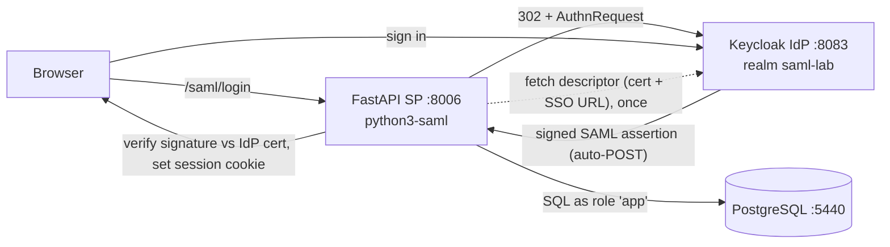

# Architecture

> Scope: the FastAPI **Service Provider** and the Keycloak **Identity Provider** it federates with.
> Status: **learning lab** — plain HTTP, self-signed everything, no Single Logout. Harden before real use.
> Sibling labs: `../../keycloak-jwt-python` (JWT), `../../oauth2-bff-python` (OAuth BFF), `../../api-key-python`,
> `../../mtls-python`.

## 1. Purpose

A FastAPI resource server that authenticates users via **SAML 2.0 SSO**: Keycloak (the IdP) authenticates the
user and returns a **digitally-signed XML assertion**; FastAPI (the SP) verifies that signature and trusts the
identity. Reads are public; writes require the session the SP issues after a successful assertion.

The central idea: **trust is established by a signature, not a shared secret.** The SP never sees the password
and shares no key with the IdP — it only holds the IdP's public certificate to verify assertions.

## 2. System context



## 3. Service internals

```
app/
├── main.py          app, CORS, routers, /health, /me
├── config.py        settings (SP entity id / base URL, IdP descriptor URL, session secret)
├── saml.py          python3-saml settings from the IdP descriptor; request adapter; session sign/verify
│                    (onelogin/xmlsec imported lazily so host tests don't need the native lib)
├── dependencies.py  current_user: writes need the session cookie the ACS issued
├── routers/saml.py  /saml/login, /saml/acs, /saml/metadata
├── routers/         users.py, profiles.py (writes gated)
├── services/, models/, db.py
```

## 4. The SAML flow (SP-initiated)

| Step | Endpoint | What happens |
|---|---|---|
| 1 | `GET /saml/login` | `python3-saml` builds an AuthnRequest; 302 to the IdP SSO URL |
| 2 | (Keycloak) | user signs in; Keycloak builds a Response with a **signed assertion** |
| 3 | `POST /saml/acs` | `auth.process_response()` verifies the signature against the IdP cert, checks conditions / audience / destination; we read the NameID and issue a signed session cookie |
| 4 | any write | `current_user` requires that cookie |

**The Destination landmine:** `python3-saml` checks the Response `Destination` against the SP's current URL.
The container listens on `:8000` but the browser posts to `:8006`, so the request adapter builds `http_host`
from the **Host header** (`localhost:8006`) — otherwise ACS fails with "received at X instead of Y".

## 5. Key decisions

| # | Decision | Why |
|---|---|---|
| D1 | **Keycloak IdP + python3-saml SP** | the standard SAML pair; the SP code is small, the library does the XML/crypto |
| D2 | **Verify assertions, don't share a secret** | the SP holds only the IdP's public cert (from its descriptor) |
| D3 | **Issue our own session cookie after ACS** | the signed assertion is consumed once; subsequent requests use a cheap signed cookie |
| D4 | **Run the SP in Docker** | `xmlsec1` (native) is impractical on a Windows host; the image apt-installs it |
| D5 | **Lazy `onelogin` import** | so the host test suite can import the app and test the session/CRUD logic without xmlsec |
| D6 | **Keycloak on in-container H2** | one less database; realm re-imports on a fresh start — fine for a lab |

## 6. Known gaps (lab only)

1. **No Single Logout (SLO).** `/saml/sls` isn't wired; logging out of the SP doesn't end the IdP session.
2. **SP doesn't sign its AuthnRequests** and doesn't request encrypted assertions.
3. **Session cookie, not a store.** Revocation waits for cookie expiry (like the BFF lab's tradeoff, minus the DB).
4. **Plain HTTP, self-signed, admin/admin, seeded alice** — all lab-only.

## 7. Testing

| Level | What | Where |
|---|---|---|
| Auth/session | cookie gate: none / tampered / valid; writes 401 vs 201; `/me` | [tests/test_auth.py](../tests/test_auth.py) |
| CRUD | full lifecycle + cascade + 409, auth overridden, SQLite | [tests/test_crud.py](../tests/test_crud.py) |
| E2E | the real signed-assertion SSO via `../../../saml_login_test.py` | by script |

Run pytest in the container (`docker compose run --rm server python -m pytest -q`) — the host has no xmlsec.
