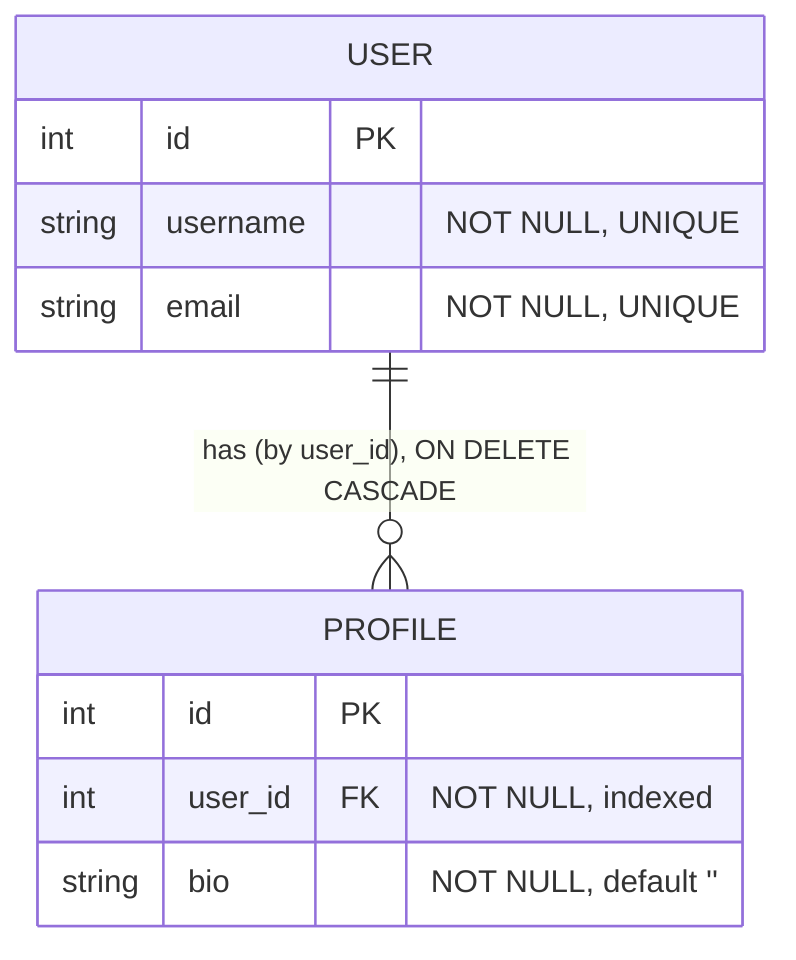

# Data model

> What data this service owns. Context: [architecture.md](architecture.md) · paths: [dataflow.md](dataflow.md).

Two tables in PostgreSQL database `app` — the users-and-profiles CRUD, identical to the sibling labs.

See [models/users.py](../app/models/users.py), [models/profiles.py](../app/models/profiles.py), migration `0001`.

## The credential is not stored

There is no accounts table and no sessions table. Identity comes from the **signed SAML assertion** Keycloak
issues; the only thing persisted about a login is nothing — after verifying the assertion the SP issues a
**signed cookie** (`saml_session`, HMAC over `{sub, exp}`) that it re-verifies on each request. The trust anchor
is the **IdP's signing certificate**, fetched from Keycloak's descriptor at runtime, never stored in the DB.

Accounts (alice) live in **Keycloak** (in-container H2 in this lab), not here. A SAML login authorizes writes; it
doesn't own rows (no owner/role model in this lab).
