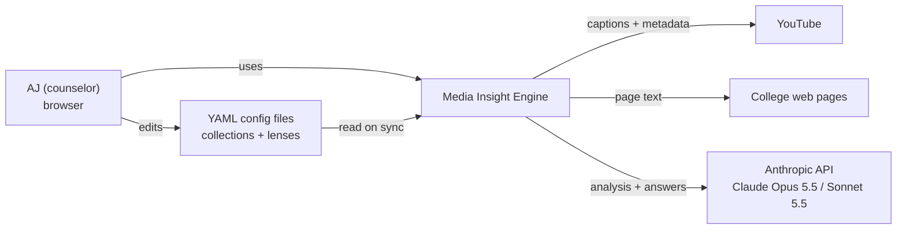
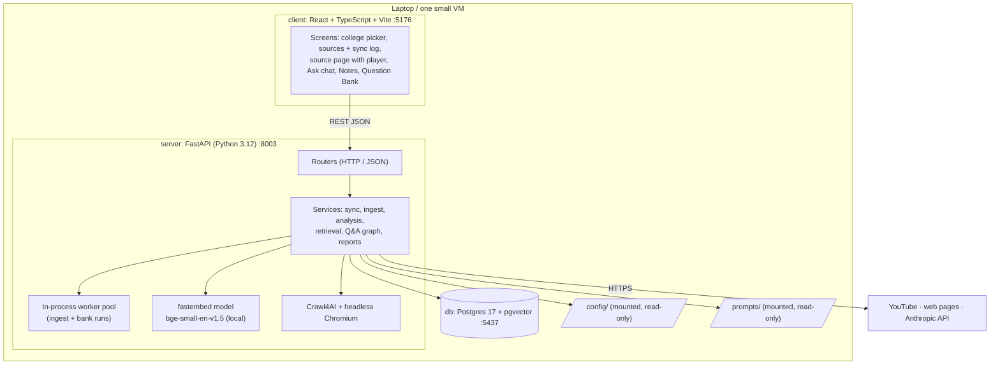

# Architecture

> Status: **Day 1 + Day 2 built** (approved before coding; updated during the builds, including what was measured and fixed). Related docs: [datamodels.md](datamodels.md) · [dataflow.md](dataflow.md) · [api-contract.md](api-contract.md).

## 1. What the system does

AJ is a counselor helping a student apply to Yale (then other Ivy+ schools). The system turns long admissions videos and web pages into a **searchable, timestamped knowledge base**, and answers questions **only from that material**, with links to the exact minute or paragraph.

Two ideas shape everything:
- **The Lens.** A short text in a config file (domain, reader, focus, tag list) is included in every analysis and every answer. Swapping the Lens reuses the app for another subject **without code changes**.
- **Grounding.** Every summary, tag and answer must trace back to stored segments. *No segment, no claim.* This rule is **enforced in code**, not just asked of the model.

Success (PRD): paste 10 Yale essay questions and, within minutes, get a report where every question has a grounded answer plus 2–5 links that open the video at the right moment.

## 2. Constraints that drive the design

| Constraint (PRD) | Consequence here |
|---|---|
| Runs with **one command** | Docker Compose: `db`, `server`, `client` |
| **Simplest thing that works**: one process, one database, no queue, no auth on Day 1 | Background work runs in a thread pool inside the API process; Postgres holds everything, including vectors |
| Every segment keeps `source_id`, `start_s`, `end_s`, raw text | `segments` table; citations built from it |
| Prompts in plain files | `prompts/*.md`, mounted into the container |
| Model and cost are not constraints | Strongest model where quality matters most (Opus for analysis), fast model where latency matters (Sonnet for Q&A) |
| A 35-min source ready in < 5 min; an answer in < 10 s | One analysis call per source; local embeddings; hybrid retrieval with indexes; low-effort answer model |
| API keys only in env | `.env` (gitignored) → container environment |
| Not on Day 1: microservices, Kubernetes, accounts, source-entry UI, fine-tuning, agent frameworks | All respected, **except one deliberate choice**: the Q&A step is a small LangGraph graph (section 6, decision D7) |

## 3. System context



Only text leaves the machine: transcripts and page text go to the Anthropic API for analysis and answering. No audio or video is downloaded on Day 1.

## 4. Containers (docker compose)



| Container | Image / base | Port (host) | State |
|---|---|---|---|
| `db` | `pgvector/pgvector:pg17` | 5437 → 5432 | named volume `pgdata` |
| `server` | `python:3.12-slim` + Chromium (Crawl4AI, also prints report PDFs) + fastembed model + faster-whisper `large-v3-turbo` baked in | 8003 | stateless (everything in `db`) |
| `client` | `node:22` (Vite dev server on Day 1) | 5176 | none |

The ports avoid the PostgreSQL 17 already running on the host (5432) and the other labs in this monorepo.

## 5. Inside the server

```
server/
├── schema.sql                 # applied idempotently at startup
├── app/
│   ├── main.py                # FastAPI app, CORS, startup (schema, re-queue stuck jobs)
│   ├── dependencies.py        # DB connection, settings, Anthropic client
│   ├── config.py              # settings (env) + YAML loading and validation (collections, lenses)
│   ├── db.py                  # psycopg 3 pool + pgvector registration
│   ├── sync.py                # CLI: python -m app.sync yale   (= make sync COLLECTION=yale)
│   ├── golden.py              # CLI: python -m app.golden yale (AC-11)
│   ├── models/                # Pydantic: API schemas (match openapi.yaml) + LLM output schemas
│   ├── routers/               # collections, sources, ask, banks, notes: thin, no logic
│   └── services/
│       ├── sync.py            # config ⇄ DB diff → queue / skip / archive → sync log
│       ├── jobs.py            # ThreadPoolExecutor, status updates, crash recovery
│       ├── youtube.py         # captions (youtube-transcript-api) + metadata (yt-dlp)
│       ├── web.py             # Crawl4AI → clean Markdown → sections
│       ├── feeds.py           # Day 2: podcast RSS → episodes (defusedxml)
│       ├── audio.py           # Day 2: yt-dlp download → faster-whisper → timed lines, progress %
│       ├── pdf.py             # Day 2: pypdf text per page
│       ├── segment.py         # captions → N-second windows; Markdown → sections
│       ├── analyze.py         # Opus call + output checks (chapters, tags, quotes)
│       ├── embed.py           # fastembed, batch embedding
│       ├── retrieve.py        # vector + full-text search, RRF merge, filters
│       ├── qa_graph.py        # LangGraph: retrieve → answer → (rewrite → retrieve) → finalize
│       ├── links.py           # deep links, app links, time labels
│       └── banks.py           # bank runs (parallel), report items, Markdown export
└── tests/
```

Rules:
- **Routers are thin.** They validate input, call one service and map to API models.
- **Services hold the logic** and are tested without HTTP.
- **Every call to Claude goes through one helper** (in `dependencies.py`). It sets the model, effort, structured output, the server-side refusal fallback and retries, and records the model name and latency.
- **Prompts are loaded from `prompts/` on each call**, so editing a prompt file takes effect on the next request without a restart.

## 6. Key decisions

| # | Decision | Why | Alternatives rejected |
|---|---|---|---|
| D1 | **YAML files are the source of truth** for sources and the Lens; sync is idempotent and archives instead of deleting | PRD FR-1: small, reviewable, version-controlled input; no source-entry UI on Day 1 | Admin screens (later), DB as master (not reviewable) |
| D2 | **One process, no queue**: a thread pool inside FastAPI; job state lives in `sources.status` | PRD "simplest thing that works"; single user | Celery/RQ + Redis (extra moving parts) |
| D3 | **Postgres + pgvector** for everything, including vectors | One database; transactions keep segments and embeddings consistent | Separate vector DB |
| D4 | **Hybrid retrieval**: vector search + Postgres full-text, merged with reciprocal-rank fusion | Embeddings miss exact tokens such as "SAT", names and years; full text catches them | Vector only |
| D5 | **Local embeddings (fastembed, bge-small, 384-d)** | No extra API key, fast on CPU, enough for thousands of segments; the model is baked into the image | Voyage / OpenAI embeddings (extra key) |
| D6 | **Opus 5.5 for analysis, Sonnet 5.5 for answers** | Analysis runs once per source and decides summary quality; answers must be under 10 s | One model for both |
| D7 | **LangGraph only for Q&A** (retrieve → answer → one rewrite-and-retry when coverage is weak → finalize) | User's choice. It adds a useful self-check (retry when weak) and keeps the loop explicit and testable. Ingest stays plain Python because it's a fixed pipeline. This is a **conscious deviation** from the PRD's "no agent frameworks on Day 1" | Plain function (PRD default); full agent with tools |
| D8 | **Grounding enforced in code**: citations validated, chapter times computed from segment indexes, quotes verified verbatim, tags limited to the Lens list, staleness computed from dates | The model can be wrong; the product promise is that it *cannot* cite what doesn't exist | Trusting the prompt alone |
| D9 | **Crawl4AI for web pages** (headless Chromium) | Handles JavaScript-rendered pages; clean Markdown with headings for section anchors | trafilatura (fails on JS pages), plain HTTP |
| D10 | **Only listed URLs** are fetched; no link-following | PRD: AJ controls every source; keeps sync predictable | Deep crawl (possible later via a `crawl:` option) |
| D11 | **Chat state lives in the client** (`history` sent with each question) | Stateless server, nothing to expire or clean up | LangGraph checkpointer / server sessions |
| D12 | **Citations stored as snapshots** in answers and notes | Saved answers keep working after re-ingest or archive | Foreign keys only |
| D13 | **Local speech-to-text (faster-whisper large-v3-turbo, CPU int8)**, one transcription at a time in its own worker pool | Private and free; best accuracy on names and numbers. Cost: ~2× the episode length on this machine (§8). Its own pool so long jobs never block web/PDF/video ingest | Cloud STT (fast, but sends audio out and needs a key); `small.en` (faster, less accurate; one env var away) |
| D14 | **An RSS entry expands into one source per episode** | Episodes are what gets cited and played; the feed is just a list | One source per feed |
| D15 | **Report PDF printed by the image's Chromium** | Already installed for Crawl4AI: no new dependency, real links in the PDF | WeasyPrint / ReportLab |

## 7. Grounding guardrails

| Risk (PRD §8) | Guardrail | Where |
|---|---|---|
| Hallucinated advice | Answer prompt sees **only** retrieved segments; every sentence needs `[n]`; finalize removes unknown `[n]`; no valid citation → "Not covered in your sources" + closest segments | `qa_graph.py` (answer + finalize) |
| Invented timestamps | Model returns segment *indexes*; code turns them into seconds | `analyze.py` |
| Misquoted officers | Key quotes kept only if found verbatim in the transcript; labelled "verbatim" in the UI | `analyze.py`, client |
| Stale policy | Publish date on every citation; sources older than 18 months, or with no date, raise a warning to verify on the official site | `qa_graph.py` (finalize) |
| Caption errors (names, numbers) | Raw transcript shown next to every summary and citation snippet; the user can play the moment | API + client |
| Synthesis mistaken for quotes | Answers labelled "Summary of sources" | API `label` + client |
| Cross-college leakage | `collection_id` filter in every retrieval query unless the user picks "All colleges" | `retrieve.py` |
| Prompt injection inside a web page or transcript | Source text is passed as quoted data inside the user message, never as instructions; the system prompt says to ignore instructions found in sources | `prompts/*.md` |

## 8. Performance budget

| Step | Budget | How |
|---|---|---|
| Captions + metadata (YouTube) | ~5 s | `youtube-transcript-api` + `yt-dlp --skip-download` |
| Web page | ~5–10 s | one Chromium page load. Pages are crawled **one at a time**, because Crawl4AI's internal SQLite cache gives "database is locked" when crawls run in parallel |
| Analysis of a 35-min video (~35 segments) | ~60–120 s | **one** Opus call, structured output |
| Embeddings | < 2 s | local, batched |
| **Source ready** | **< 5 min (target ~2 min)** | 2 ingest workers, so several sources run side by side |
| Podcast episode | **~2× the episode length**: does **not** meet the PRD target | measured on this machine (Docker Desktop on Windows, 8 CPU threads; Whisper uses 4–6 of them): a 36:42 episode took **1 h 15 min** from sync to ready, about **2× the episode's length**. Breakdown below. `WHISPER_MODEL=small.en` in `.env` is several times faster but less accurate (not measured yet) |
| PDF (40 pages) | ~1–2 min | download + pypdf + one analysis call |
| Retrieval | < 200 ms | HNSW + GIN indexes |
| Answer | 3–6 s | Sonnet 5.5, low effort, top-10 segments |
| Weak answer with retry | +3–5 s | one rewrite + second retrieval, at most once |
| **Ask** | **< 10 s** | |
| 10-question bank | ~20–40 s | 4 questions in parallel |

Measured podcast timeline ("What Yale Looks For, Part 1", 36:42, 44 MB MP3):

| Step | Time |
|---|---|
| Download (44 MB) | 20 s |
| Load the 1.6 GB Whisper model | ~3 min (190 s), **only for the first podcast after a server start**; it then stays in memory (~2 GB RAM) |
| Decode the MP3 + voice-activity detection | ~1 min |
| Speech recognition | ~68 min (≈ 0.55× real time; the first 5 % is slowest) |
| Analysis (Opus) + embeddings | ~2 min |
| **Total, sync → ready** | **1 h 15 min** |

The estimate before measuring was 12–20 min; CPU-only Whisper inside Docker on Windows turned out about 4× slower. Memory: with the model loaded the server uses ~2.3 GB of Docker's ~7.4 GB, so don't load a second copy alongside it (a test that did got the container OOM-killed).

Known limits:
- One analysis call handles about 200 segments (~3 h of video). Longer sources need the analysis split into chunks.
- Crawl4AI starts a browser per page. Share one browser if many web sources appear.
- The worker pool is per process, so don't run several server replicas.
- Podcasts are transcribed one at a time: a backlog of N episodes takes about N × 2 × their length.
- **Recreating the server container (`docker compose up --build`, or `up` after changing `.env` or the image) interrupts a running transcription.** On startup the episode is re-queued and starts again from 0 %. Rebuild when no podcast is transcribing.
- `GET /collections` falls back to a college's last synced data when its YAML is currently broken, so a broken file can look fine in the UI until you press Sync (which then shows the 422 error).

## 9. Cross-cutting concerns

- **Configuration:** settings come from the environment (`ANTHROPIC_API_KEY`, `DATABASE_URL`, `ANALYSIS_MODEL=claude-opus-5-5`, `ANSWER_MODEL=claude-sonnet-5-5`, `INGEST_WORKERS=2`, `BANK_WORKERS=4`, `WHISPER_MODEL=large-v3-turbo`). Collections, lenses and prompts come from mounted files. `.env` is read when a container is **created**: after editing it run `docker compose up -d` (a `restart` keeps the old values).
- **Errors:**
  - Ingest failures become `status=failed` with a readable `error`, and are never silent.
  - Model failures are retried by the SDK (429/5xx).
  - A refusal (`stop_reason == "refusal"`) after the server-side fallback marks the source failed, or the answer "not covered", with the reason.
  - HTTP errors use `{detail}`.
- **Logging:** structured logs per request and per job (source id, step, duration, model, tokens). The model name and latency are stored on `answers` for tuning.
- **Security:**
  - No auth on Day 1 (local, single user).
  - CORS only for the client's origin.
  - Secrets only in `.env`.
  - Transcripts stay in the local database (terms of use: personal research, no republishing).
  - If hosted for Aksh (open question in the PRD), add basic auth at the proxy.
- **Testing:**
  - Unit tests for every service with Claude faked: config, URL normalization, segmenting, sync diff, quote checks, citation validation, staleness, Q&A graph routing.
  - A contract test compares FastAPI's generated `/openapi.json` with `docs/openapi.yaml`.
  - Acceptance checks AC-1…AC-10 run by hand on real Yale content.
  - The golden test set (`python -m app.golden yale`) must score ≥ 8/10 (AC-11).
  - Day 2 adds:
    - RSS parsing from a fixture feed, and sync with feeds (episodes, keep, archive, Spotify, bad regex);
    - the progress reporter, and audio/PDF links;
    - a **real PDF printed by the image's Chromium** read back page by page;
    - `report.pdf` returning a real PDF;
    - and a **real audio decode through faster-whisper**, which catches dependency breaks like the PyAV one below.
  - Run inside the stack: `docker compose exec server pytest -q` (75 tests). Client: `npm test` (42) and `npm run build`.
- **Dependency pins** (`server/requirements.txt`, all pinned to tested versions):
  - `av==18.1.0`: PyAV 19 removed `av.open(metadata_errors=…)`, which faster-whisper 1.2.1 still passes, so every podcast failed with "open() got an unexpected keyword argument 'metadata_errors'". Unpin only when faster-whisper supports PyAV 19 (the decode test will tell).
  - `yt-dlp` and `youtube-transcript-api`: bump them when YouTube changes break captions or downloads.
- **Client development in Docker:** Windows bind mounts don't deliver file-change events into containers, so Vite polls (`VITE_USE_POLLING=1` in `docker-compose.yml`). Without it the dev server keeps serving stale code after edits.

## 10. How Day 2 and later plug in

| Later feature | Where it plugs in |
|---|---|
| ~~Podcasts (MP3/RSS) + faster-whisper~~ | **built on Day 2** (`feeds.py`, `audio.py`, audio pool, in-app player) |
| ~~PDF ingest~~ | **built on Day 2** (`pdf.py`, page segments, `#page=` links) |
| ~~PDF export~~ | **built on Day 2** (`GET /bank-runs/{id}/report.pdf`) |
| More colleges | new YAML files only, no code changes |
| Re-analyze on Lens change | compare `collections.lens_text` with the stored analysis lens; re-queue the affected sources |
| Read-only view for Aksh | basic auth plus a read-only role in the client |
| Scheduled ingest of new episodes | a timer that runs the existing sync |

## 11. Run it

```bash
cp .env.example .env          # add ANTHROPIC_API_KEY yourself
docker compose up --build     # db + server + client (first build ~15 min: Chromium, embedding and Whisper models)
make sync COLLECTION=yale     # Windows: docker compose exec server python -m app.sync yale
# open http://localhost:5176
```
