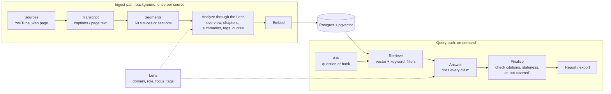
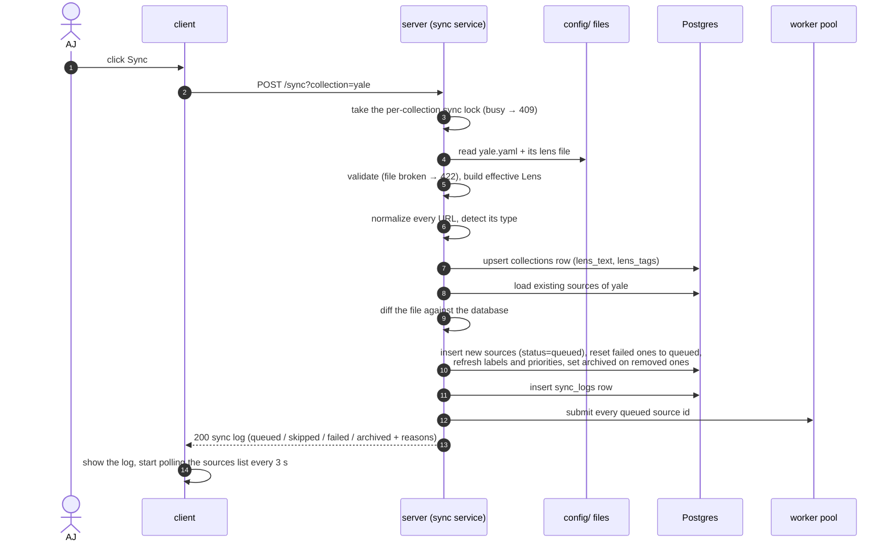
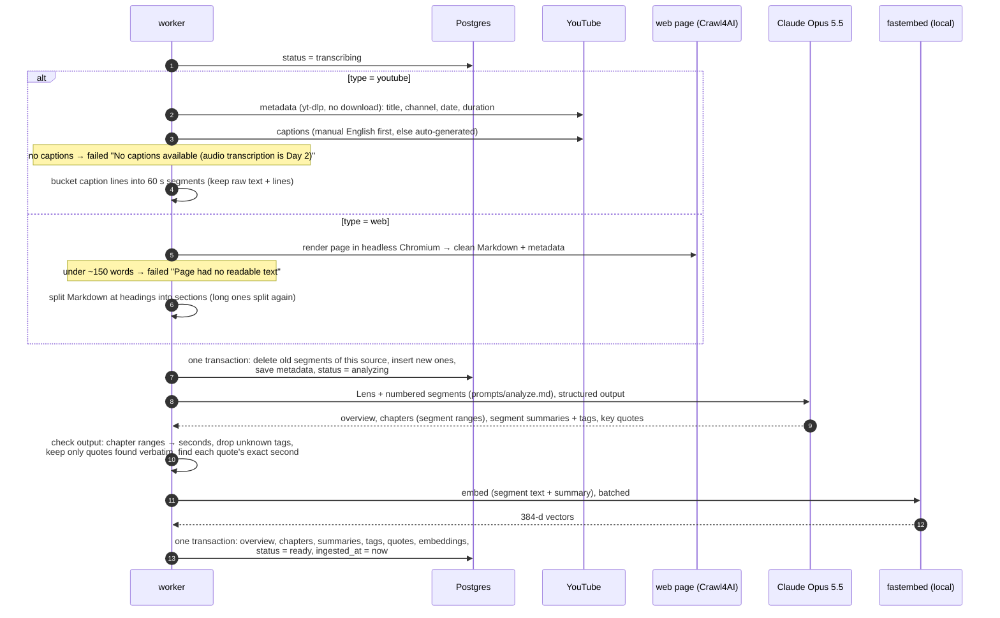
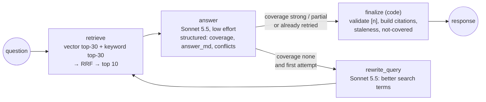
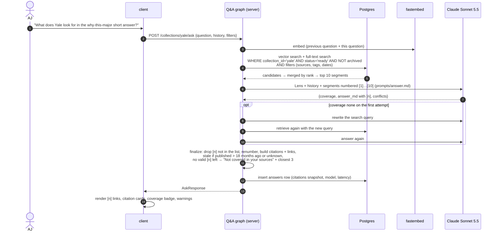
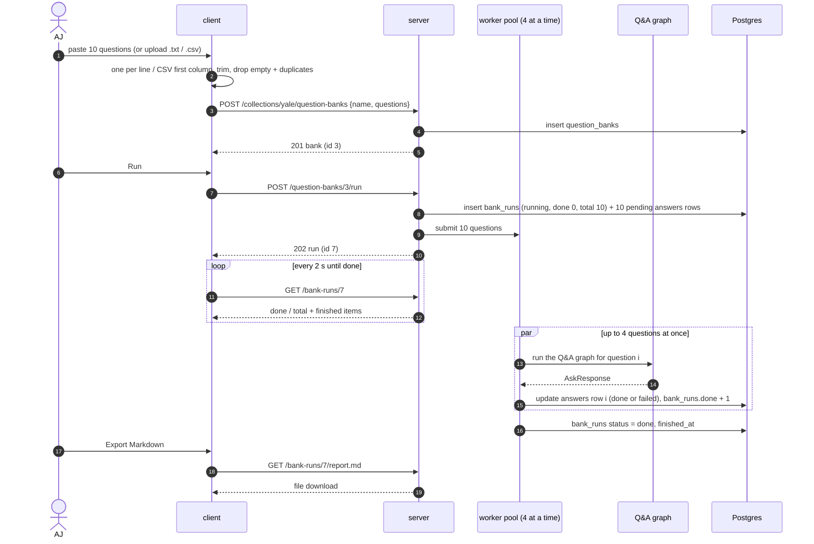

# Data flow

> Status: **Day 1 built**. Related docs: [architecture.md](architecture.md) · [datamodels.md](datamodels.md) · [api-contract.md](api-contract.md).

The system has **two paths that share one store** (PRD §5):

The sections below follow one piece of data through each flow, in the order AJ uses the app.

---

## 1. Sync: config file → sources (FR-1)

Triggered by `make sync COLLECTION=yale` (CLI) or the **Sync** button (`POST /sync?collection=yale`). Both run the same service.

How each URL is decided:

| In the file? | In the database? | Current state | Action | Log reason |
|---|---|---|---|---|
| yes | no | — | insert, `queued` | "New URL" |
| yes | yes | `ready` | nothing | "Already ready" |
| yes | yes | `queued` / `transcribing` / `analyzing` | nothing | "Already being ingested (…)" |
| yes | yes | `failed` | reset to `queued` | "Retrying (last error: …)" |
| yes | yes | `archived` | un-archive, then the rows above | "Restored" + state |
| no | yes | not archived | `archived = true` | "Removed from yale.yaml" |
| yes, but invalid | — | — | nothing | the validation message |
| yes, Day-2 type | — | — | nothing | "Type 'audio' is not supported until Day 2" |

Because of these rules, running sync twice in a row gives "skipped" for everything (AC-9). Nothing is deleted, and nothing is left out of the log (FR-1.4).

The CLI variant does the same, then waits for its queued sources to finish and prints a line per source with the time it took. That's how AC-1 ("ready in under 5 minutes each") is measured.

---

## 2. Ingest: one source → ready (FR-2, FR-3)

Each queued source runs in a worker thread. Every step writes its result before moving on, so the status the UI polls is always true.

What a 35-minute YouTube video becomes (AC-2):

| Item | Count | Example |
|---|---|---|
| Source row | 1 | title, channel, `published_at`, `duration_s = 2112` |
| Segments | ~35 | `720–780 s`, raw text, "Officers want the origin of the interest…", `[essays, why-major]` |
| Chapters | 3–8 | `570–1065 s` "Supplemental essays" |
| Key quotes | ≤ 10 | `731 s` "we really want to hear what got you curious…" (verbatim) |
| Embeddings | ~35 | one per segment |

Failures at any step set `status = failed` with a readable `error` and stop that source only. The next sync retries it. If the server restarts mid-job, startup sets the source back to `queued` and resubmits it.

---

## 3. Looking at a source (FR-3.6)

`GET /sources/12` reads `sources` plus its segments, chapters and quotes. It computes `deep_link` per segment and quote.

On the source page, the client:
- embeds the YouTube player using `ext_id`;
- seeks to `?t=` on load;
- makes every chapter, timeline row and quote call `player.seekTo(start_s)` when clicked (AC-3: within ±5 s).

Web sources render as sections with `id="seg-<id>"`.

---

## 4. Ask: question → grounded answer (FR-4)

`POST /collections/yale/ask` runs the **Q&A graph** (LangGraph).

How the outcomes map to acceptance checks:

| Situation | Result | AC |
|---|---|---|
| Sources answer it | answer with ≥ 2 citations, each opening the right moment | AC-4 |
| Cited video older than 18 months | `stale_warning`: verify on the official site; date shown on every citation | AC-5 |
| Sources don't cover it | "Not covered in your sources", plus closest moments; no invented answer | AC-6 |
| A web page was added and synced | its sections can be retrieved and cited with a `#:~:text=` link | AC-7 |
| Asked in Yale while MIT is also synced | the `collection_id = 'yale'` filter means MIT can't appear | AC-10 |

Follow-up questions: the client sends `history`. The graph uses the previous question in the search and the earlier turns in the answer prompt. The server keeps no session.

**Save to notes:** `POST /notes` stores the question, the answer and the citation snapshot as they are.

---

## 5. Question bank: many questions → report (FR-5)

Each report item is built like this (FR-5.3):
- **short answer:** the `answer_md` of that question;
- **watch these:** the cited segments in retrieval order, at most 5. Fewer appear only when fewer were cited, and "not covered" questions show none;
- **coverage:** strong / partial / none.

One failed question is marked `failed` with its error and does not stop the run. The Markdown export lists every question with its answer, coverage and timestamp links (AC-8). For PDF on Day 1, the browser's print dialog saves the report page.

---

## 6. Golden test set (AC-11)

`python -m app.golden yale` reads `golden/yale.yaml`, which AJ fills in with 10 questions, each with an expected source URL and timestamp plus a tolerance. For each question it:
1. runs the same Q&A graph;
2. checks whether any citation is the expected source within the tolerance;
3. prints a table and the score.

The target is ≥ 8 of 10. Run it after every prompt, segment-size or retrieval change. The PRD says to tune retrieval before rewording prompts.

---

## 7. Where each kind of data is written

| Step | Writes |
|---|---|
| Sync | `collections` (upsert), `sources` (insert / reset / archive / refresh labels), `sync_logs` |
| Ingest: transcript | `sources` metadata + status, `segments` (raw text, times, caption lines) |
| Ingest: analysis + embed | `sources.overview`, `chapters`, `segments.summary/tags/embedding`, `key_quotes`, status `ready` |
| Ask | `answers` (chat answer, `run_id` null) |
| Bank | `question_banks`, `bank_runs`, `answers` (one per question) |
| Notes | `notes` |

Nothing is ever hard-deleted by sync. The only deletes are explicit user actions (delete note, delete bank), plus replacing a failed source's segments when it is retried.

## 8. Failure handling at a glance

| Failure | Seen as | Recovery |
|---|---|---|
| Bad YAML file | `POST /sync` → 422 with file and field | fix the file, sync again |
| Bad source entry | `failed` line in the sync log | fix the entry, sync again |
| No captions / blocked / page empty | source `failed` + reason | Day 2 audio, or replace the URL |
| Model error after retries / refusal | source `failed`, or answer "not covered" with reason | sync again (retries failed sources) / ask again |
| Server restart mid-ingest | source stays `transcribing`/`analyzing` until startup re-queues it | automatic |
| Bank question fails | that item `failed` + error, run continues | run the bank again |
| Two syncs at once | second gets 409 | wait, retry |
