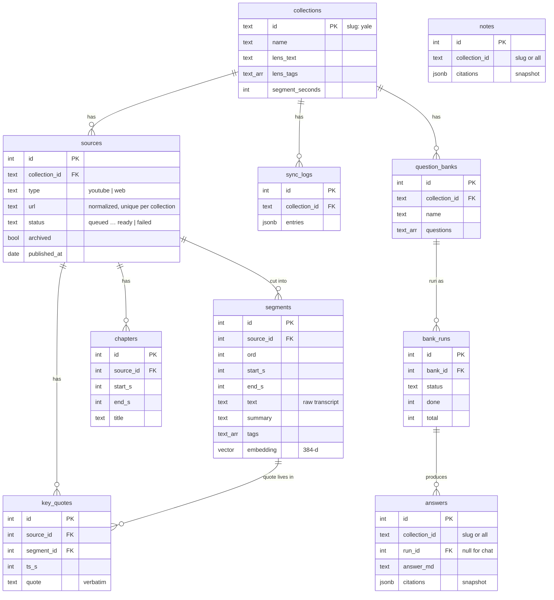
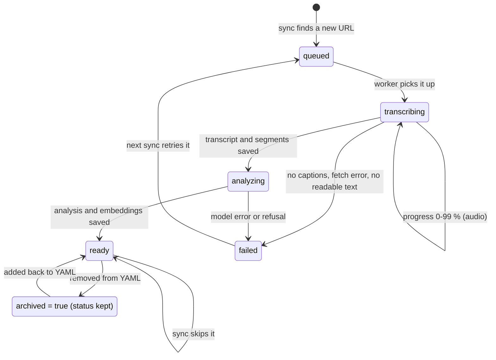

# Data models

> Status: **Day 1 built**; this document describes the implemented schema. Related docs: [architecture.md](architecture.md) · [dataflow.md](dataflow.md) · [api-contract.md](api-contract.md) / [openapi.yaml](openapi.yaml).

The app stores data in three places. Each has one job:

| Where | What | Who edits it |
|---|---|---|
| **YAML config files** (`config/`) | which colleges exist, their sources and their Lens | AJ, by hand, under version control. **The source of truth for *what* to ingest** |
| **Prompt files** (`prompts/`) | the wording sent to Claude | AJ / developers. Changes apply without a rebuild |
| **PostgreSQL 17 + pgvector** | everything the app *produces*: transcripts, segments, summaries, embeddings, answers, notes | only the server |

The one rule every table serves (PRD §2): **every answer, summary and tag traces back to segments. No segment, no claim.** That's why every segment keeps `source_id`, `start_s`, `end_s` and the raw `text`, and why citations are stored as snapshots.

---

## 1. Config files

### 1.1 Collection: `config/collections/<slug>.yaml`

The file name is the collection id (`yale.yaml` → `yale`). The slug must match `^[a-z0-9-]+$`.

```yaml
name: Yale                         # required, display name
lens: undergrad-admissions         # required: a file in config/lenses/ …
# lens:                            # … or an inline lens / partial override (see 1.3)
#   extends: undergrad-admissions
#   focus: "Also flag anything about residential colleges"
focus_note: Early Action, class of 2031      # optional, appended to the lens text
tags: [ea-ed, essays]              # optional: extra tags added to the lens vocabulary
sources:
  - url: https://www.youtube.com/watch?v=XXXX      # required
    label: Admissions podcast – supplemental essays # optional
    type: youtube                  # optional: youtube | web | audio | pdf | rss (auto-detected when omitted)
    priority: high                 # optional: high | normal (default) | low
    notes: Listen for the why-major part            # optional, for AJ only (not sent to Claude)
  - url: https://feeds.example.com/inside-yale     # Day 2: a podcast RSS feed
    type: rss
    episodes: 10                   # newest N episodes (default 10)
    match: "essay|testing"          # optional: only episodes whose title matches (regex, any case)
```

An `rss` entry is not a source itself. Each selected episode becomes its own `audio` source with `feed_url` set, and its title, date and duration come from the feed. Episodes that later drop out of the newest N are kept. Removing the feed entry archives all its episodes.

Validation (Pydantic, on every sync):

| Problem | Result |
|---|---|
| File missing, not YAML, no `name`, unknown lens | the **whole sync fails** with HTTP 422 and a message naming the file and field |
| One bad source entry (no `url`, not http(s), unknown `type`, duplicate URL in the file) | only **that entry** is logged as `failed` with the reason; the rest sync normally |
| Spotify URL (DRM-protected audio) | entry logged `failed: "Spotify audio is DRM-protected: use the show's RSS feed instead"` |
| Feed can't be read / has no audio episodes | the feed line is logged `failed` with the reason; its earlier episodes stay |

### 1.2 Lens: `config/lenses/<name>.yaml`

```yaml
name: undergrad-admissions
domain: Undergraduate college admissions (US, Ivy+)
reader_role: A counselor helping a student applicant
focus: >
  Essays and supplements, testing policy, major fit, Early Action / Early Decision strategy,
  what admissions officers say they look for.
tags: [testing, essays, why-major, ea-ed, extracurriculars, recommendations, interviews, financial-aid]
segment_seconds: 60               # 30–300, default 60 (PRD FR-3.3)
stale_after_months: 18            # PRD FR-4.5
```

### 1.3 How the effective Lens is built (FR-1.5)

1. Load the shared lens named by `lens:`, or `lens.extends:`.
2. Any field given inline in the college file **replaces** the shared field. `tags` from the college file are **added** to the lens tags.
3. `focus_note` is appended to the focus text.
4. The result is rendered into **`lens_text`**, one block of plain text sent to Claude, and **`lens_tags`**, the allowed tag list. Both are stored on the `collections` row at sync time.

If AJ changes a lens, the next sync stores the new text, and **new** sources are analyzed with it. Re-analyzing existing sources when the lens changes is Week 2+ in the PRD.

---

## 2. Database

### 2.1 Entity-relationship diagram



`answers.collection_id` and `notes.collection_id` have **no foreign key**, because they may hold `all`.

### 2.2 Tables

The DDL lives in `server/schema.sql`. It is applied at every server start and is idempotent (`CREATE … IF NOT EXISTS`). There is no migration tool on Day 1; add Alembic once the schema has to change on a database holding real data.

#### `collections`: one row per config file that has been synced
| Column | Type | Notes |
|---|---|---|
| `id` | `text` PK | slug (`yale`) |
| `name` | `text` not null | from the YAML |
| `lens_name` | `text` not null | shared lens name, or `inline` |
| `lens_text` | `text` not null | effective lens, rendered (1.3) |
| `lens_tags` | `text[]` not null | allowed tag vocabulary |
| `focus_note` | `text` | |
| `segment_seconds` | `int` not null | 30–300 (`CHECK`) |
| `stale_after_months` | `int` not null, default 18 | |
| `last_synced_at` | `timestamptz` | |
| `created_at` | `timestamptz` default `now()` | |

`GET /collections` also lists config files **without** a row yet (never synced), with zero counts.

#### `sources`: one ingested item (FR-2)
| Column | Type | Notes |
|---|---|---|
| `id` | `bigint` identity PK | |
| `collection_id` | `text` FK → collections | |
| `type` | `text` | `CHECK (type IN ('youtube','web','audio','pdf'))` |
| `url` | `text` not null | **normalized** (2.4) |
| `ext_id` | `text` | YouTube video id (for the player and `youtu.be` links) |
| `label`, `priority`, `notes` | `text` | from the YAML, refreshed on every sync |
| `title`, `host` | `text` | from metadata (channel / site name) |
| `published_at` | `date` | null = unknown (treated as possibly stale) |
| `duration_s` | `int` | video and audio |
| `progress` | `int` 0–100 | Day 2: speech-to-text progress while `transcribing`; null otherwise |
| `feed_url` | `text` | Day 2: the RSS feed an episode came from (index); protects it from archiving while the feed is listed |
| `media_url` | `text` | Day 2: playable audio URL for the in-app player (feed enclosure, direct MP3, or resolved by yt-dlp) |
| `status` | `text` not null | `queued`, `transcribing`, `analyzing`, `ready`, `failed` (`CHECK`) |
| `error` | `text` | human-readable reason when `failed` |
| `archived` | `bool` not null default false | removed from the YAML; excluded from retrieval, **never deleted** |
| `overview` | `text` | FR-3.1 |
| `analysis_model` | `text` | which model produced the analysis (for later re-analysis) |
| `created_at`, `updated_at`, `ingested_at` | `timestamptz` | `ingested_at` = became `ready` |

Constraint: `UNIQUE (collection_id, url)`, the de-duplication rule (FR-2.5). The same URL may exist in two collections; they stay separate rows (FR-1.6).

#### `segments`: the unit everything cites (FR-3.3)
| Column | Type | Notes |
|---|---|---|
| `id` | `bigint` identity PK | |
| `source_id` | `bigint` FK → sources `ON DELETE CASCADE` | |
| `ord` | `int` not null | 0, 1, 2 … within the source; `UNIQUE (source_id, ord)` |
| `start_s`, `end_s` | `int` not null | **video / audio:** seconds. **web / pdf:** section number (`start_s = end_s = ord`) |
| `anchor` | `text` | web: the section heading; pdf: `Page N` |
| `text` | `text` not null | raw transcript / section text, **never rewritten** |
| `summary` | `text` | 1–2 sentences (null until analyzed) |
| `tags` | `text[]` not null default `{}` | subset of `collections.lens_tags` |
| `embedding` | `vector(384)` | `BAAI/bge-small-en-v1.5`, built from `text` + `summary` |
| `tsv` | `tsvector` **generated** | `to_tsvector('english', text ‖ ' ' ‖ coalesce(summary,''))`, for keyword search |
| `snippets` | `jsonb` | video and audio: the original caption / speech-to-text lines `[{start, text}]`. Used to put a key quote on its exact second |

Indexes: HNSW `embedding vector_cosine_ops`; GIN on `tsv`; GIN on `tags`; btree `(source_id, ord)`.

#### `chapters` (FR-3.2)
| Column | Type | Notes |
|---|---|---|
| `id` | identity PK | |
| `source_id` | FK cascade | |
| `ord` | `int` | |
| `start_s`, `end_s` | `int` | **computed by code** from the first and last segment Claude names, never typed by the model |
| `title` | `text` | |
| `summary` | `text` | 2–3 sentences |

#### `key_quotes` (FR-3.5)
| Column | Type | Notes |
|---|---|---|
| `id` | identity PK | |
| `source_id` | FK cascade | |
| `segment_id` | FK → segments cascade | the segment that contains the quote |
| `ts_s` | `int` | start of the caption line where the quote begins |
| `quote` | `text` | **verified** to occur in the segment text (case- and whitespace-insensitive), otherwise not stored |
| `is_advice` | `bool` | direct advice from the speaker |

At most 10 per source.

#### `sync_logs` (FR-1.4)
| Column | Type | Notes |
|---|---|---|
| `id` | identity PK | |
| `collection_id` | FK | |
| `created_at` | `timestamptz` | |
| `summary` | `jsonb` | `{queued, skipped, failed, archived}` counts |
| `entries` | `jsonb` | `[{url, label, action, reason, source_id}]`, exactly as the API returns it |

#### `question_banks` (FR-5.1)
| Column | Type | Notes |
|---|---|---|
| `id` | identity PK | |
| `collection_id` | FK | |
| `name` | `text` | |
| `questions` | `text[]` | 1–100, cleaned by the client |
| `created_at` | `timestamptz` | |

#### `bank_runs` (FR-5.2)
| Column | Type | Notes |
|---|---|---|
| `id` | identity PK | |
| `bank_id` | FK → question_banks cascade | |
| `status` | `text` | `running`, `done`, `failed` |
| `done`, `total` | `int` | progress |
| `filters` | `jsonb` | the Ask filters used for every question |
| `created_at`, `finished_at` | `timestamptz` | |

Partial unique index `ON bank_runs(bank_id) WHERE status = 'running'` makes "one run per bank at a time" (HTTP 409) a database rule.

#### `answers`: every answer produced, from chat or a bank run (FR-4, FR-5.3)
| Column | Type | Notes |
|---|---|---|
| `id` | identity PK | |
| `collection_id` | `text` | slug or `all` |
| `run_id` | FK → bank_runs cascade, nullable | null = asked in chat |
| `item_index` | `int` | position in the bank |
| `question` | `text` | |
| `status` | `text` | `pending`, `done`, `failed` (bank items); chat answers are stored `done` |
| `answer_md` | `text` | with `[n]` markers |
| `coverage` | `text` | `strong`, `partial`, `none` |
| `citations` | `jsonb` | **snapshot** of the API `Citation` objects (title, date, times, snippet, links) |
| `closest` | `jsonb` | snapshot, when not covered |
| `watch` | `jsonb` | the report's "watch these" list: cited citations in retrieval order, max 5 |
| `stale_warning`, `conflicts`, `error` | `text` | |
| `retried` | `bool` | the Q&A graph rewrote the search once |
| `model`, `latency_ms` | `text`, `int` | for tuning and the golden test set |
| `created_at` | `timestamptz` | |

#### `notes` (FR-4.6)
| Column | Type | Notes |
|---|---|---|
| `id` | identity PK | |
| `collection_id` | `text` | slug or `all` |
| `question`, `answer_md`, `coverage` | `text` | |
| `citations` | `jsonb` | snapshot, as sent by the client |
| `comment` | `text` | |
| `created_at` | `timestamptz` | |

### 2.3 Why citations are snapshots

A note saved today must still open the right moment after the source is archived or re-ingested. So `answers` and `notes` keep the **whole citation** (title, date, `start_s`, snippet, `deep_link`), not just a `segment_id`. The `segment_id` is kept too, for "play here" while the segment still exists.

### 2.4 URL normalization (de-duplication key)

| Input | Stored as |
|---|---|
| `https://youtu.be/ID?t=30`, `youtube.com/watch?v=ID&list=…`, `youtube.com/shorts/ID`, `m.youtube.com/watch?v=ID` | `https://www.youtube.com/watch?v=ID` (+ `ext_id = ID`) |
| any URL | lower-case scheme and host, drop `#fragment`, drop `utm_*` / `fbclid` / `gclid`, drop trailing `/` (except the root) |

Two entries that normalize to the same URL in one file → the second one is logged `failed: "Duplicate of entry N in the file"`.

### 2.5 Status lifecycle of a source



- `archived` is a separate flag, so an archived source keeps its last status and its data.
- Feed episodes are archived only when their feed entry is removed from the YAML (not when they drop out of the newest N).
- When a `failed` source is retried, its old segments, chapters and quotes are deleted in the same transaction before new ones are written, so a source never has half old and half new data.
- When the server restarts, sources stuck in `transcribing` or `analyzing` are set back to `queued` and resubmitted.

---

## 3. Model input and output schemas (Claude)

The prompts live in `prompts/*.md`. The schemas are Pydantic models in `server/app/models/llm.py` and are sent as structured-output schemas, so responses are validated JSON.

### 3.1 Source analysis (Opus 5.5): `SourceAnalysis`
Input: `lens_text`, `lens_tags`, source title/host/date, then the numbered segments `[i] mm:ss–mm:ss  text`.

```text
SourceAnalysis
  overview:   str                                 # one paragraph: presenters, audience, coverage, why it matters for the lens
  chapters:   [ { first_seg: int, last_seg: int, title: str, summary: str } ]     # 3–8 for a 35-min video
  segments:   [ { i: int, summary: str, tags: [str] } ]                            # one per input segment
  key_quotes: [ { seg: int, quote: str, is_advice: bool } ]                        # ≤ 10
```

After the model replies, the code checks the output:
- `chapters` are mapped to seconds from the segment boundaries. Overlapping or out-of-range chapters are dropped.
- `tags` outside `lens_tags` are dropped.
- Each `quote` must be found in segment `seg` (case- and whitespace-insensitive), or it is dropped.
- A missing segment summary leaves `summary = null`, so the segment is still searchable by its text.

### 3.2 Answer (Sonnet 5.5): `AnswerDraft`
Input: `lens_text`, the chat history, and the retrieved segments numbered `[1]…[k]`, each with title, date and time label.

```text
AnswerDraft
  coverage:  "strong" | "partial" | "none"
  answer_md: str            # plain text with [n] markers; every sentence must carry one
  conflicts: str | null     # where sources disagree
```

### 3.3 Query rewrite (Sonnet 5.5): `Rewrite`
```text
Rewrite
  query: str                # a better search query for one retry
```

The finalize step (code, not the model) turns `AnswerDraft` into the API's `AskResponse`:
- it keeps only the `[n]` markers that point at retrieved segments;
- it builds the `Citation` objects and links;
- it computes `stale` and `stale_warning` from `published_at`;
- it switches to "Not covered in your sources" when nothing valid remains.

---

## 4. API objects ↔ storage

| API object ([openapi.yaml](openapi.yaml)) | Built from |
|---|---|
| `Collection` | YAML file + `collections` row + counts over `sources` |
| `SyncLog` | `sync_logs` row |
| `SourceSummary` / `SourceDetail` | `sources` (+ `segments`, `chapters`, `key_quotes`); `deep_link` computed |
| `Citation` | `segments` ⋈ `sources`, plus computed `label`, `deep_link`, `app_link`, `stale` |
| `AskResponse` | finalize step output; also saved to `answers` |
| `QuestionBank` | `question_banks` + latest `bank_runs.id` |
| `BankRun` / `ReportItem` | `bank_runs` + its `answers` rows (`watch` = cited citations in retrieval order, max 5) |
| `Note` | `notes` row |

## 5. Deep links (computed, never stored on segments)

| Source type | `deep_link` | `app_link` |
|---|---|---|
| YouTube | `https://youtu.be/<ext_id>?t=<start_s>` | `/sources/<id>?t=<start_s>` |
| Web | `<url>#:~:text=<first ~6 words of the section, URL-encoded>` | `/sources/<id>#seg-<segment_id>` |
| Audio | `<media_url>#t=<start_s>` (media fragment) | `/sources/<id>?t=<start_s>` (in-app `<audio>`) |
| PDF | `<url>#page=<N from "Page N">` | `/sources/<id>#seg-<segment_id>` |

Citation and report snapshots *do* store the computed links, so they keep working later.

## 6. Not stored
- **Audio or video files:** captions are fetched; when audio must be transcribed it is downloaded to a temporary folder and deleted right after (PRD terms-of-use guardrail: personal research, no republishing).
- **API keys:** `ANTHROPIC_API_KEY` is read from the environment only (`.env`, gitignored).
- **Users or passwords:** single user and no auth on Day 1.
- **Chat sessions:** the client sends `history` with each question; each answer is stored in `answers`, but there is no session table.
